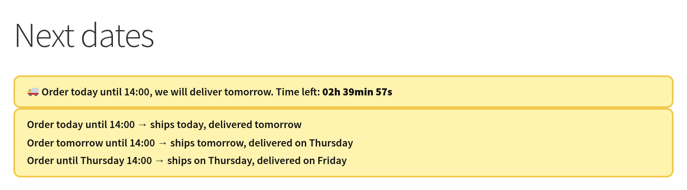
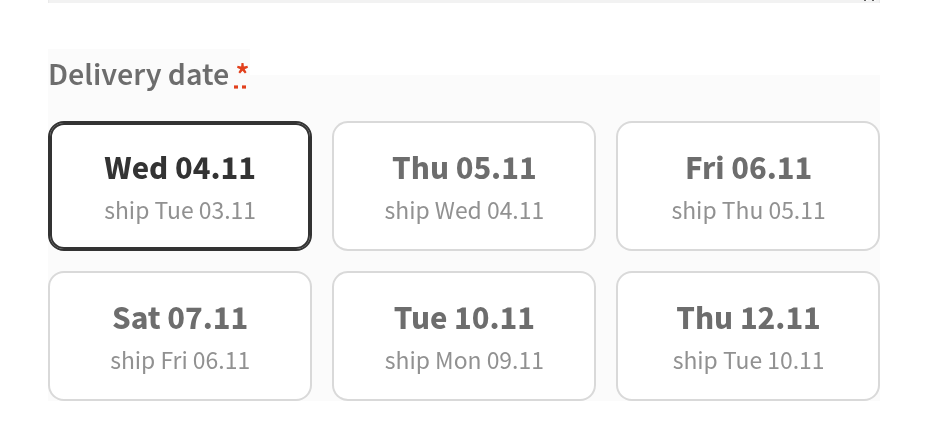
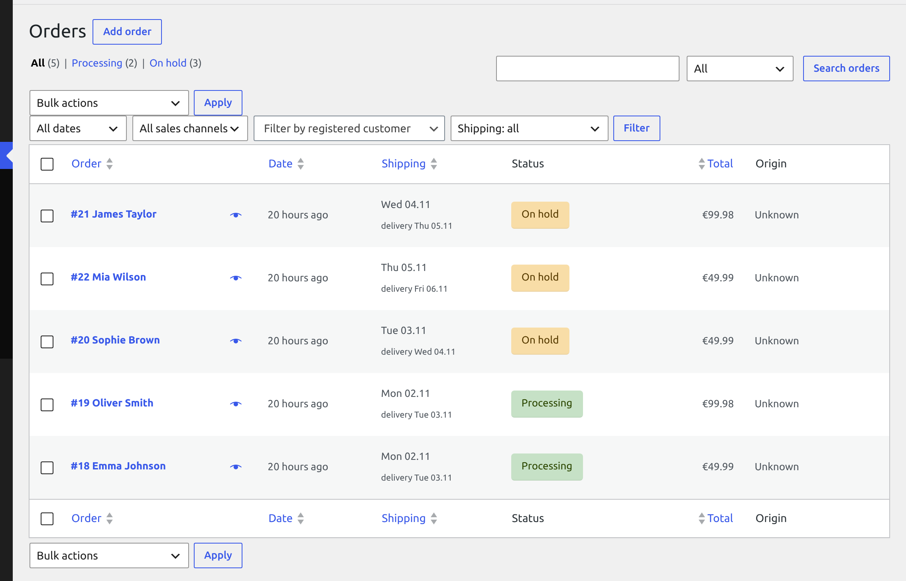
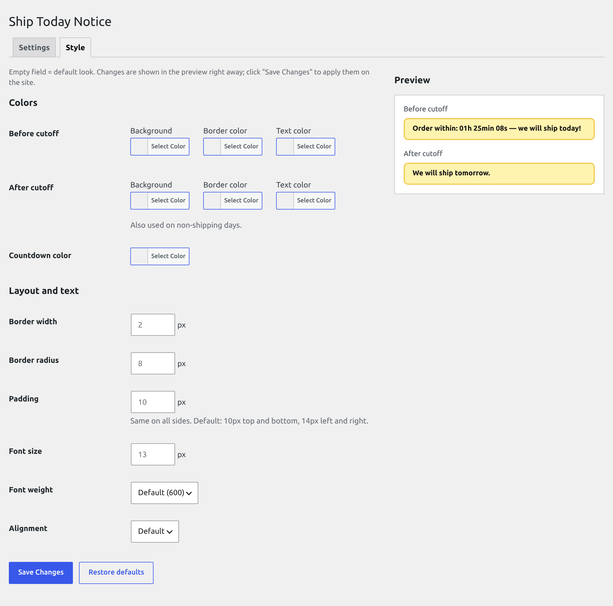
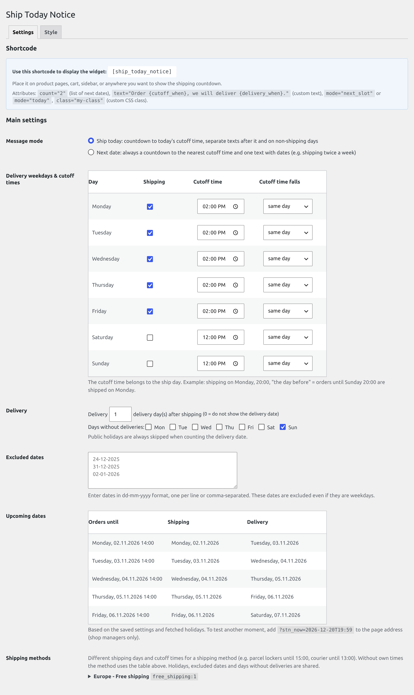

<h1 align="center">WooCommerce Ship Today Notice</h1>

<p align="center"><b>English</b> | <a href="README.pl.md">Polski</a></p>

<p align="center">
  <b>"Order within 2h 39min and we'll ship today!"</b><br>
  A countdown to the order cutoff, the ship day and the delivery date in your WooCommerce store,<br>
  plus a delivery date choice at checkout that goes to the order, emails and admin.
</p>

<p align="center">
  
  
  
  
  
  
  
  
</p>

<p align="center">
  
</p>

## Why

A customer who doesn't know when the parcel will arrive puts off buying. This plugin tells them right where they decide:

- **on the product page and in the cart** - how much time is left until the cutoff and when the parcel leaves ("today", "tomorrow", "on Monday"),
- **at checkout** - the customer picks a delivery date, and you get it in the order, the email and the orders list,
- **without watching the calendar** - holidays download on their own, weekends and days without deliveries are skipped, and after
  the cutoff the widget switches to the next date by itself, on cached pages too.

## Screenshots

<table>
  <tr>
    <th width="50%">Date tiles at checkout</th>
    <th width="50%">Shipping column in the orders list</th>
  </tr>
  <tr>
    <td valign="top"></td>
    <td valign="top"></td>
  </tr>
</table>

**Style tab** - set the look of the widget in the admin, with a live preview:

<p align="center"></p>

<details>
<summary>Settings: shipping days, cutoff times and the upcoming dates preview</summary>

<p align="center"></p>

</details>

## Features

**The `[ship_today_notice]` widget**
- Two modes: **ship today** (a countdown to today's cutoff) and **next date** (always the next shipment, for example when you ship twice a week).
- Texts with tokens and correct weekday forms: "until Sunday 20:00", "on Tuesday", "bis Sonntag", "do niedzieli".
- A list of several upcoming dates (`count="3"`), custom text and a CSS class in the shortcode.
- **Works with cached pages** - a 42-day schedule sits in the HTML and the browser works out the state. LiteSpeed Cache is purged at the cutoff.
- **Style tab** - colors, border, font and alignment set in the admin with a live preview, no CSS needed.

**Schedule**
- Shipping days and a cutoff time per day, including cutoffs that fall earlier (ship on Monday, orders until Sunday 20:00).
- Delivery date: N delivery days after shipping, skipping days without deliveries and holidays.
- **Holidays** from the [OpenHolidays API](https://www.openholidaysapi.org/) for your country, optionally with a region (e.g. `DE-BY`),
  with the option to ignore selected ones. Plus a manual list of excluded dates.

**Checkout and orders** (optional module)
- **Classic checkout** - date tiles. **Block checkout** - the same tiles as a "Ship date" block you can move in the editor (WooCommerce 10.1+).
- The server checks the date when the order is placed. A date that closed while the page was open is rejected with a message.
- Ship and delivery dates in emails, on the thank-you page, in My Account, in the order admin (editable) and in an orders list
  column with sorting and a filter.
- **Cutoff times per shipping method** (e.g. parcel locker until 15:00, courier until 13:00): tiles and validation follow the selected
  method, and changing the method recalculates the tiles.
- Local pickup doesn't require a date. HPOS compatible.
- A switch that turns off Iconic Delivery Slots during a migration.

**For developers**
- `wc_stn_*` functions, filters, a cache purge action, `window.WcShipTodayNotice.init()`.
- Test mode `?stn_now=2026-12-20T19:59` - the widget, tiles and validation at any moment in time.
- All texts are translatable. pl_PL and de_DE are included.

## Quick start

1. Upload the plugin to `wp-content/plugins/wc-ship-today-notice/` and activate it (WooCommerce must be active).
2. Go to **WooCommerce → Ship Today Notice**, select the shipping days and set the cutoff times.
3. Optionally set **Delivery** (delivery days after shipping) and check the **Upcoming dates** table.
4. Add the shortcode to a product page, the cart or the header:

   ```
   [ship_today_notice]
   [ship_today_notice mode="next_slot" text="Order {cutoff_when}, we will deliver {delivery_when}. Time left: {countdown}"]
   ```

5. Optionally enable **Ship date choice at checkout** and open the **Style** tab.

Holidays download by themselves right after activation (WP-Cron). To get them immediately, use "Fetch holidays now" at the bottom of the settings.

## Requirements

| | |
|---|---|
| WordPress | 6.8+ (since 6.8 WordPress loads translations from the plugin's `languages/` directory by itself) |
| PHP | 7.4+ |
| WooCommerce | 9.4+ (tested up to 11.2). Date choice at block checkout: **10.1+** - on older versions the block isn't registered and orders go through without a date. |
| Permissions | admin page and saving settings: `manage_woocommerce` (shop managers can change them too) |

HPOS and block checkout compatibility are declared (`FeaturesUtil::declare_compatibility`). The order code uses WooCommerce CRUD
and supports both the HPOS orders list and the legacy posts table.

## What works out of the box, and what you need to enable

| Feature | Default | Where to enable | Notes |
|---|---|---|---|
| `[ship_today_notice]` widget | yes, once the shortcode is added | shortcode | "Display widget" = Always. The widget JS and CSS load only on pages with the widget (shortcode detected in the content/short description or rendered; filter `wc_ship_today_notice_load_assets`). |
| Message mode | "Ship today" | Message mode / `mode` attribute | |
| Shipping days | Mon-Fri, until 14:00 the same day | Delivery weekdays & cutoff times | Sat/Sun default to 12:00 but aren't selected. |
| Delivery date | no (0 days) | Delivery | Days without deliveries default to Sunday. |
| Cutoff times per shipping method | no (all methods use the main table) | Shipping methods → Own shipping days and cutoff times for this method | For each method instance in your WooCommerce zones. Both checkouts follow the selected method, the widget uses the `method` attribute. |
| Holidays | once downloaded | WP-Cron right after activation, every ~4 months, after changing the country/language/region, or "Fetch holidays now" | Country and language: PL, no region (nationwide holidays only). |
| Automatic holiday download (OpenHolidays requests without a click) | yes | Public holidays API → Automatic download | Off: cron events are removed and holidays download only with "Fetch holidays now". |
| Excluded dates | none | Excluded dates | |
| Text after the cutoff / on non-shipping days | yes | checkboxes next to the texts | Applies to "ship today" mode. |
| Seconds in the countdown | yes | Countdown format | |
| Custom widget look | no (styles from `notice.css`) | **Style** tab | Empty field = default look. |
| Ship date choice at checkout | **no** | Ship date choice at checkout → Module | Default position: `[ship_today_checkout]` shortcode only. |
| Date row in the checkout order summary | yes, with the module | Ship date choice at checkout → Dates in orders | Both checkouts. |
| "Ship date" / "Planned delivery" rows: emails, thank-you page, My Account | yes, with the module | same | |
| Order admin: dates | with the module | automatic | The box appears only when the order has dates or they can be changed. |
| Order admin: changing the ship date | yes, with the module | Dates in orders | Off: the dates are read-only. |
| "Shipping" column, sorting and filter in the orders list | yes, with the module | Dates in orders | HPOS and the legacy posts table. |
| Dates of existing orders while the module is off | **no** | Dates in orders | On: rows in emails/thank-you page/My Account, the order admin (read-only) and the list work without the module, according to the switches above. |
| Turning off Iconic Delivery Slots | no | Iconic Delivery Slots | The field shows only with Iconic active and works only with the module on. |
| Cache purge at the cutoff | yes, with LiteSpeed Cache active or the `wc_ship_today_notice_purge_cache` action hooked | Advanced → Optional features | The cache is always purged after saving the settings. |
| WPML | yes, with WPML active | Advanced → Optional features | Four widget texts are registered when saving the settings and shown translated. |
| Test mode `?stn_now=` | yes | Advanced → Optional features | Only for `manage_woocommerce`. |
| Functions, filters, JS API | yes | code | |

Every switch defaults to the previous behavior, and when off it doesn't register its hooks (cron: the event isn't scheduled or gets
removed). With the checkout module off, the plugin doesn't register its hooks. Dates already saved in orders stay in the meta and are
shown only with the "Show dates of existing orders also when the module is disabled" switch on.

## Documentation

<details>
<summary><b>Shortcode, modes and visibility</b></summary>

```
[ship_today_notice]
[ship_today_notice mode="next_slot"]
[ship_today_notice count="2" text="Order until {cutoff_day} {cutoff_time} and get it {delivery_day}."]
[ship_today_notice class="my-class"]
```

| Attribute | Default | Description |
|---|---|---|
| `count` | `1` | How many upcoming dates to show (1-10). With `count > 1` the container gets the `wc-ship-today-notice--list` class. Every date (even a single one) is wrapped in `.wc-ship-today-notice__item`. |
| `text` | from settings | Custom text with tokens. Replaces all texts from the settings (before / after the cutoff / non-shipping day / next date). HTML is filtered with `wp_kses_post`. |
| `mode` | from settings | `today` or `next_slot`. |
| `class` | - | Extra CSS classes for the container (space-separated). |
| `method` | - | Shipping method instance ID, e.g. `flat_rate:3` - dates follow its own cutoff times ("Shipping methods" section). Without the attribute, or for a method without its own times or one that was deleted, the main schedule applies. The widget doesn't detect the customer's method because the page may be cached. |

With "Display widget" set to Disabled, the shortcode returns an empty string and the script and style aren't loaded.

**Modes**

- **Ship today** (`today`) - before today's cutoff: "Text before cutoff" with the countdown. After it, on a shipping day:
  "Text after cutoff". On a non-shipping day (weekday, holiday, excluded date): "Text when not a shipping day".
- **Next date** (`next_slot`) - always a countdown to the next cutoff and one text ("Text in "next date" mode").
  The "only before cutoff" visibility option behaves like "always" here.

With `count > 1` the first date uses the state text, the following ones use the "next date" text.

**Visibility**

| Setting | Behavior |
|---|---|
| Disabled | The widget and its assets are off. |
| Always visible | Always. |
| Only before cutoff time | Hidden after the cutoff in "ship today" mode. |
| Only N hour(s) before cutoff | Shown only N hours (0.5-168) before the cutoff. |

Regardless of this, the widget is hidden when there's no date in the next 42 days.

**Countdown**: labels for hours, minutes and seconds (`h`, `min`, `s` by default) and a seconds switch. An empty label means the bare number
(e.g. `01:30`). Above 24 hours the countdown shows days ("1 day", "3 days").

</details>

<details>
<summary><b>Tokens and default texts</b></summary>

| Token | Example (English store) |
|---|---|
| `{countdown}` | `1 day 05h 12min 10s` (format set in "Countdown format") |
| `{cutoff_when}` | `today until 20:00` / `tomorrow until 20:00` / `until Sunday 20:00` |
| `{cutoff_day}` | `Sunday` |
| `{cutoff_time}` | `20:00` |
| `{cutoff_date}` | `25.10` |
| `{ship_when}` | `today` / `tomorrow` / `on Monday` |
| `{ship_day}` | `on Monday` |
| `{ship_date}` | `26.10` |
| `{delivery_when}` | `tomorrow` / `on Tuesday` |
| `{delivery_day}` | `on Tuesday` |
| `{delivery_date}` | `27.10` |

`{delivery_*}` tokens are empty when delivery = 0. "Today" and "tomorrow" are worked out by the browser in the store's time zone, so
they stay correct on cached pages. Unknown tokens stay in the text unchanged.

Weekday forms depend on the store language (`_x()` translations in `.po`): "do niedzieli 20:00", "we wtorek" in Polish,
"bis Sonntag 20:00", "am Dienstag" in German.

Default texts (a text saved in the settings takes priority):

| Text | Source |
|---|---|
| Next date | `Order {cutoff_when}, we will ship {ship_when}. Time left: {countdown}` |
| Before the cutoff | `Order within: {countdown} — we will ship today!` |
| After the cutoff | `We will ship {ship_when}.` |
| Non-shipping day | `We will ship {ship_when}.` |

In the "after cutoff" and "non-shipping day" texts, prefer `{ship_when}` to a fixed "tomorrow": on a Friday evening or before a
holiday the next shipment isn't tomorrow, and `{ship_when}` gives "on Monday". Saved texts exactly equal to the old defaults
are updated automatically when upgrading to 2.2.0.

</details>

<details>
<summary><b>Look and the Style tab</b></summary>

WooCommerce → Ship Today Notice → **Style**: the look of `[ship_today_notice]` without writing CSS, with a live preview of the
states before and after the cutoff.

| Option | Description |
|-------|------|
| **Before / after cutoff** | Background, border color and text color for each state. Non-shipping days use the "after" colors. |
| **Countdown color** | The color of `{countdown}`. |
| **Border width, border radius, padding, font size** | In px. Padding is one value for all sides. |
| **Font weight, alignment** | 400-800; left / center / right. |

An empty field means the default look. "Restore defaults" clears the form, and the change is saved only after "Save Changes". The style is
stored in the `wc_ship_today_notice_style` option and reaches the page as CSS variables on `:root` (inline next to `notice.css`), so it
works on cached pages too. Saving purges the cache like saving the settings does.

Container state classes: `wc-ship-today-notice--before` (before the cutoff and "next date" mode),
`--after` (after the cutoff, non-shipping day), `--hidden`. Countdown: `.wc-ship-today-countdown`.

CSS variables: `--wc-ship-today-notice-bg`, `-border`, `-color`, `-font-size`, `-before-bg`, `-before-border`, `-before-color`,
`-after-bg`, `-after-border`, `-after-color`, `-countdown-color`, `-border-width`, `-radius`, `-padding`, `-font-weight`,
`-align`, `-justify`. You can override them with your own CSS, for example on a class from the `class` attribute.

</details>

<details>
<summary><b>Ship date choice at checkout (classic, block, Iconic)</b></summary>

Enable it in **WooCommerce → Ship Today Notice → Ship date choice at checkout → Module**.

| Setting | Default | Description |
|---|---|---|
| Module | off | The field is required when the cart needs shipping, the field was in the form and the selected method isn't local pickup. |
| Position | shortcode only | `[ship_today_checkout]` (must be inside the checkout form), below the order notes (`woocommerce_after_order_notes`) or above the order review (`woocommerce_checkout_before_order_review`). |
| Field label | `Termin dostawy` | Field legend, summary row, validation message. |
| Number of dates | 6 | 1-12 tiles. |
| Select the nearest date | yes | |
| Large text on the tile | delivery date | Or ship date. Without delivery set, always the ship date. Sets the **default** tile texts ("Texts" fields below). |
| Selection color | dark gray | HEX or the `--wc-stn-accent` CSS variable. |
| Texts → Tile | as above | "Large text" (empty = default) and "Second line" (the field holds the default; **empty = no second line**, with a "Restore default" button). Tokens below. |
| Texts → Rows after the order is placed | `Ship date:` / `Planned delivery:` | Labels in emails, on the thank-you page and in My Account. Empty = translated defaults. Both rows can be turned off in "Dates in orders". |
| Texts → Messages | as before | No date selected (`{field}`), cutoff passed and date unavailable (`{slot}`), date closed while the page was open (`{slot}`, `{next_slot}`). Empty = default (shown as a placeholder). |
| Iconic Delivery Slots | - | See below. |

**Tile texts.** The tokens are the same as in the widget, calculated for the tile's date: `{ship_when}`, `{ship_day}`, `{ship_date}`, `{delivery_when}`,
`{delivery_day}`, `{delivery_date}`, `{cutoff_when}`, `{cutoff_time}`, `{cutoff_date}`, plus the short tile forms `{ship_short}`
and `{delivery_short}` (e.g. "Mon 02.11"). The default texts are templates built from these tokens: "Large text = delivery date" gives
`{delivery_short}` / `ship {ship_short}`, "ship date" gives `{ship_short}` / `delivery {delivery_short}`, and they're translated
(e.g. de `Versand {ship_short}`). Example: only the bold delivery date - leave "Large text" empty and clear "Second line".
`{delivery_*}` tokens are empty when the date has no delivery date. "Today/tomorrow" in `{*_when}` is calculated by the server when the page
opens (checkout isn't cached); tiles added after a cutoff use texts from that same moment, so only a page left open over midnight could
show an outdated "today/tomorrow". The screen reader label (`aria-label`) always holds the full ship date, delivery date and cutoff.
In messages `{slot}` / `{next_slot}` use the default large text form, regardless of custom tile texts.

Custom texts (tile, labels, messages) go through WPML like the widget texts ("WPML" switch). Empty fields use the plugin
translations, so a store in Polish or German gets the translation without any changes.

> **Note:** with the "shortcode only" position you need to add `[ship_today_checkout]` to the checkout form. Without it
> (or with the shortcode outside the form) the field won't appear and orders are placed without a ship date. The admin shows a
> warning for this setting.

**Classic checkout**

- Tiles with the next dates. When a cutoff passes while the page is open, the tile disappears, the next one comes in and the selection
  moves to the nearest date with a message. Changing the tile refreshes the summary (`update_checkout`).
- A date row in the order review table.
- The server checks the date again when the order is placed (`woocommerce_after_checkout_validation`). A date past its cutoff is rejected
  with a message.
- A date is required only if the field was in the submitted form (hidden `wc_stn_rendered` field). A missing shortcode or one
  outside the form doesn't block orders.
- Local pickup: when all selected shipping methods are pickup (`local_pickup`, `pickup_location`, filter
  `woocommerce_local_pickup_methods`), no date is required. The tiles stay: a selected date is saved in the order, and no selection
  goes through as well.
- Saved in the order through CRUD (`woocommerce_checkout_create_order`) - works with HPOS and the legacy posts table.
- "Ship date" and "Planned delivery" rows on the thank-you page, in emails (customer and admin) and in My Account
  (`woocommerce_get_order_item_totals`).
- Order admin: the dates and a "Change ship date" field (delivery recalculated automatically, order note with the user name).
  An empty field removes the dates. An invalid date (e.g. 31.02) isn't saved and the admin shows a message. The customer isn't notified of the change.
- Orders list (HPOS and legacy): a "Shipping" column after the order date, sorting and a ship date filter
  (ship dates from 14 days back to 31 days ahead). Sorting shows only orders with a date from this module.
  Iconic orders show their date marked "Iconic" (read-only, no migration).

**Block checkout**

Requires WooCommerce 10.1+ (tested on 11.3). On older versions the block isn't registered.

At block checkout the date is picked from the same tiles as in the classic one, in the **"Ship date"** block (`wc-stn/ship-date`,
an inner block of the checkout form, parent `woocommerce/checkout-fields-block`):

- **Insertion:** on the first admin visit after enabling the module, the plugin adds the block to the checkout page once
  (below "Shipping options", or before "Payment" if there are none). After that the block is yours: you can **move** it in the checkout page
  editor, **remove** it and add it again from the inserter (search for "Ship date"). A removed block isn't added back.
  Settings → "Ship date choice at checkout" shows whether the block is on the checkout page. A checkout in a theme template
  (Site Editor) isn't changed automatically - add the block there by hand.
- **Without the block** the customer doesn't pick a date and orders go through without one (sales aren't blocked). The admin then shows a
  notice (to `manage_woocommerce` users, dismissible; it comes back if the checkout page changes).
- **Upgrading from 2.2.0** (which had a select field): the block is also added in `maybe_upgrade()`, on the first admin visit after the update.
- The "Number of dates", "Select the nearest date", "Large text on the tile", "Selection color", "Field label"
  and "Texts" (tile, messages) settings work as in the classic checkout. "Position" applies only to the classic one. The block shows only when the
  cart needs shipping and local pickup isn't selected.
- When a cutoff passes while the page is open, the tile disappears, the next one comes in and the selection moves to the nearest date with a message.
- The date goes to the Store API as `extensions.wc-stn.ship_date` (with `rendered: true` when the block was visible). When the order is placed
  (`woocommerce_store_api_checkout_update_order_from_request`) the server requires a date only with `rendered`, rejects a missing
  date and a date outside the current list, and saves the same meta as the classic checkout, so emails, the thank-you page,
  the order admin and the orders list work the same.
- JS without a build step (`assets/blocks/ship-date/`: `block.json`, `editor.js`, `frontend.js`), look from `checkout.css`.
- **Order summary row** - the "Ship date summary row" block (`wc-stn/ship-date-row`, in the summary totals,
  parent `woocommerce/checkout-order-summary-totals-block`) shows the selected date like the row in the classic checkout
  (the label is "Field label"). It changes right after picking a tile and after a cutoff passes. The plugin adds it once below
  the shipping row (like the tiles block, with a separate `wc_ship_today_notice_row_inserted` marker); you can move or remove it.
  A page with the older summary layout (total rows directly in `checkout-order-summary-block`, without
  `checkout-order-summary-totals-block`) is migrated to the new layout at that point: the WooCommerce editor does the same when
  opening the page and drops unknown blocks while doing it, so the row has to be in the totals block already.
  If the row can't be added, the checkout section of the settings shows it in red and the plugin retries on the next admin visit.
  There's no row when the "Row with the date in the order summary at checkout" switch is off, when the page has no tiles block or when no date is selected.
  Both blocks share the selected date through the `wc-stn/ship-date` `wp.data` store.
- The Iconic switch works only in the classic checkout.

**Migrating from Iconic Delivery Slots**

With Iconic active, the settings show "Disable Iconic Delivery Slots in the cart and checkout". With the module on, the plugin then:

- returns `false` in `iconic_wds_delivery_slots_allowed`,
- removes (on `wp_loaded` 99) Iconic's hooks for fields, data, validation and saving meta,
- replaces the `[iconic-wds-fields]` shortcode with an empty string,
- turns off the `jckwds-script` script and `jckwds-style` style in the cart and checkout.

Iconic stays active in the admin (old orders, its column and the Deliveries page), but new orders no longer reach it.
Tested on Iconic 2.13.0. To roll back, uncheck the switch and restore `[iconic-wds-fields]` at checkout.

**Order meta**

| Key | Value |
|---|---|
| `_wc_stn_ship_date` | ship date `Y-m-d` |
| `_wc_stn_delivery_date` | delivery date `Y-m-d` or an empty string |
| `_wc_stn_cutoff` | timestamp of the selected date's cutoff (removed on a manual date change) |

Read only for display (Iconic): `jckwds_date` (order admin), `jckwds_date_ymd` (orders list).

</details>

<details>
<summary><b>Cutoff times per shipping method</b></summary>

WooCommerce → Ship Today Notice → **Shipping methods** (below "Upcoming dates"): a list of all methods from your WooCommerce shipping
zones (including "Rest of the world" and methods from plugins, such as parcel lockers), each as a `method:instance` instance
(e.g. `flat_rate:3`), so different zones and countries can have different times.

- The "Own shipping days and cutoff times for this method" checkbox opens the same table as the main one (shipping days, cutoff time,
  offset) and an optional number of delivery days (empty = as in "Delivery"). Below it there's a preview of the method's next 5 dates.
- A method without its own times, with the checkbox off, or deleted in WooCommerce uses the main schedule.
- Shared by all methods: holidays, excluded dates, days without deliveries.
- Stored in the `wc_ship_today_notice_method_schedules` option (`["flat_rate:3" => [enabled, delivery_days, cutoff_times,
  cutoff_offsets, delivery_offset]]`). Without it the plugin works exactly as before.

How it works:
- **Classic checkout:** tiles for the selected method (first package). After a method change, `update_checkout` returns the new method's dates
  (the `#wc-stn-checkout-data` fragment) and the tiles are recalculated. The selection stays if the same visible date
  (large tile text) or the same ship date exists for the new method; otherwise it moves to the nearest one with a message
  (Texts, tokens `{slot}`, `{next_slot}`). The summary row, validation and order data follow the selected method.
- **Block checkout:** the "Ship date" block gets dates for each method with its own times and picks them by the rate selected
  in the cart (`wc/store/cart`). Changing the method works as in the classic checkout. Store API validation follows the selected method.
- **Local pickup:** no change, no date required.
- **Order admin:** changing the ship date calculates delivery by the order's shipping method.
- **Widget:** the `method="flat_rate:3"` attribute (one method). The cache purge (LiteSpeed / action) runs at the nearest cutoff
  across all schedules.
- Test mode `?stn_now=` works when the page opens, but not in the checkout recalculation AJAX (`update_order_review`) -
  after a method change the tiles count from the real current time.

</details>

<details>
<summary><b>Holidays</b></summary>

Source: [OpenHolidays API](https://www.openholidaysapi.org/), current and next year, for the country and language in the settings
(`[A-Z]{2}`; an invalid code isn't saved and the previous one stays, with a message).

- **When downloaded:** right after activation (a single WP-Cron event), every ~4 months, immediately after saving the settings with a changed
  country, language or region, and with "Fetch holidays now". If a cron download fails (network, API), it retries in 6 hours.
- **An empty or invalid response** (no network, HTTP error, empty list, non-JSON) doesn't delete stored holidays for that year.
- **Regional holidays** (`nationwide: false` in the API, e.g. Corpus Christi in some German states) are skipped. The **Region** field (ISO 3166-2 code,
  e.g. `DE-BY`) adds holidays of that region and its parent regions (region `DE-BY-AU` gets `DE-BY` and `DE-BY-AU` holidays, region
  `DE-BY` doesn't get holidays of Augsburg alone). Codes: `https://openholidaysapi.org/Subdivisions?countryIsoCode=DE`. A region from another
  country is cleared with a message. The API returns no regional holidays for Poland, so nothing changes there.
- **Multi-day holidays** (`startDate`..`endDate`, e.g. New Year 1-2.01 in SI, RO, RS) are stored as consecutive days.
- Single holidays can be ignored (shipping possible), and there's a manual list of excluded dates.

The API receives only the country code, language code and date range - no customer data (details in "External services" in `readme.txt`).

</details>

<details>
<summary><b>Developer API: functions, filters, actions, JS</b></summary>

**PHP functions** (dates as `Y-m-d` in the store time zone)

| Function | Returns |
|---|---|
| `wc_stn_get_slots( $count = 1, $now = null, $method = null )` | the next dates whose cutoff hasn't passed: an array of `['cutoff' => DateTimeImmutable, 'ship' => DateTimeImmutable, 'delivery' => ?DateTimeImmutable]`. `$now` accepts `DateTime` or `DateTimeImmutable`. `$method` = shipping method instance ID (`flat_rate:3`), `null` = main schedule. |
| `wc_stn_delivery_for_ship_date( $ship_ymd, $method = null )` | the delivery date for a ship date (`Y-m-d` or `Ymd`), or `null` when delivery = 0 or the date is invalid |
| `wc_stn_is_blocked_date( $ymd )` | whether the date is a non-ignored holiday or an excluded date (regardless of the weekday); `false` for an invalid date |
| `wc_stn_is_shipping_day( $ymd, $method = null )` | whether it's a shipping day (weekday from the settings, not a holiday, not excluded); `false` for an invalid date |

**Filters**

| Filter | Arguments | Purpose |
|---|---|---|
| `wc_ship_today_notice_now` | `DateTimeImmutable $now` | Replace "now" (used by test mode). |
| `wc_ship_today_notice_is_shipping_day` | `bool $is`, `string $ymd`, `?string $method` | Custom shipping days / blocks. |
| `wc_ship_today_notice_cutoff_time` | `string $time` (`H:i`), `int $weekday` (1 = Mon), `string $ship_ymd`, `?string $method` | A different cutoff for a specific day. |
| `wc_ship_today_notice_slots` | `array $slots`, `int $count`, `DateTimeImmutable $now`, `?string $method` | Change the date list (widget, checkout, validation). |
| `wc_ship_today_notice_text` | `string $text`, `string $state` (`next`, `before`, `after`, `not_shipping`), `string $mode`, `?string $method` | Widget text before tokens are replaced. |
| `wc_ship_today_notice_load_assets` | `bool $load` (shortcode detection result) | `true` = widget JS and CSS in `<head>` on this page. Needed when the widget arrives in content loaded with AJAX (popup, PJAX). |

`$method` (last argument, optional, so old callbacks keep working) is the shipping method instance ID (`flat_rate:3`) the date is
calculated for, even if that method has no own times, or `null` for the main schedule.

The widget JS and CSS load only where the widget is:
- shortcode in the content or short description (e.g. of a product) of posts in the main query, also inside the "Shortcode" block (`core/shortcode`)
  → CSS in `<head>`, JS in the footer;
- anywhere else that renders the shortcode on the server (sidebar widget, template, page builder) → on render:
  CSS printed right before the widget (no unstyled flash), JS in the footer;
- the style from the Style tab always goes with `notice.css`.

Detection looks at posts in the main query, so for example a product list where one product has the shortcode in its short description
loads the assets even if the list doesn't display it.

**Actions**

| Action | When |
|---|---|
| `wc_ship_today_notice_purge_cache` | At the cutoff (+5 s, WP-Cron) and after saving the settings, along with `litespeed_purge_all`. Hook your own cache purge here. |

WP-Cron events: `wc_ship_today_notice_cron_sync_holidays` (holidays, every ~4 months, plus single events after activation
and on retry) and `wc_ship_today_notice_cron_purge_cache` (a single event at the next cutoff, scheduled only with LiteSpeed Cache
active or the `wc_ship_today_notice_purge_cache` action hooked; removed otherwise).

**JS**

```js
window.WcShipTodayNotice.init(root); // initializes widgets in content loaded with AJAX (popups, PJAX); root defaults to document
```

The widget reads its configuration from the `data-stn` attribute. Each element is initialized only once. If the page has no widget in the HTML
(all content arrives through AJAX), `notice.js` won't load - turn it on with the filter:

```php
add_filter('wc_ship_today_notice_load_assets', '__return_true'); // or a condition, e.g. is_front_page()
```

**Test mode**: a user with `manage_woocommerce` can add `?stn_now=2026-12-20T19:59` to any page URL. "Now" then changes in PHP
and JS (widget, tiles, checkout validation). The date is read in the store time zone.

</details>

<details>
<summary><b>Translations and WPML</b></summary>

- Text domain: `wc-ship-today-notice`. `.pot`, `pl_PL` and `de_DE` files are in `languages/`. A file in `wp-content/languages/plugins/`
  takes priority.
- All plugin texts are translatable: the admin, default widget texts, weekdays in forms that depend on their place in the sentence
  (`_x()` with context: name, "until ...", "on ...", short), "today"/"tomorrow", tiles, validation messages,
  rows in emails, the order admin and the orders list. Texts for JS (`notice.js`, `checkout.js`) come translated from PHP.
- A simplification: the countdown gets the `_n()` form for 1 and for 2 days ("1 day", "N days"); languages with another form for 5+
  days show the form for 2.
- The field name in the "select a date" message is lowercased in Polish; translating the text `yes`
  with the context "Lowercase the field label..." to `no` turns this off (as de_DE does).
- WPML: the widget texts (`text_next_slot`, `text_before_cutoff`, `text_after_cutoff`, `text_not_shipping_day`) are registered
  as strings in the `wc-ship-today-notice` domain when saving the settings.

</details>

<details>
<summary><b>Database and uninstalling</b></summary>

- Option `wc_ship_today_notice_options` - all settings (array).
- Option `wc_ship_today_notice_style` - Style tab settings (array, empty values = defaults).
- Option `wc_ship_today_notice_version` - version for migrations.
- Option `wc_ship_today_notice_method_schedules` - cutoff times per shipping method (key: method instance ID).
- Table `{prefix}wc_ship_today_notice_holidays` - downloaded holidays.

Deactivation removes all the plugin's cron events (`wp_clear_scheduled_hook`). Deleting the plugin (`uninstall.php`) removes the plugin options,
the holidays table and cron events (on every multisite site too). Order meta (`_wc_stn_*`) stays in the orders.

</details>

## Development

```bash
scripts/lint.sh            # php -l + node --check, no WordPress needed
npm install                # first time: @wordpress/env (requires Docker and Node 20+)
npm run env:start          # http://localhost:8894, admin / password
npm run env:seed           # product, classic checkout, PL shipping, cash on delivery, PL holidays
npm run test:schedule      # engine test table (tests/cli-schedule-test.php)
scripts/build-zip.sh       # build/wc-ship-today-notice.zip from committed files, without .distignore entries
npm run env:destroy        # remove the environment
```

`tests/cli-schedule-test.php` is a table of engine cases: cutoffs, holidays, regions, year change, daylight saving,
texts, API. It requires PL holidays for 2026-2027 (`env:seed`) and doesn't change saved settings.

<details>
<summary><b>File structure</b></summary>

```
wc-ship-today-notice/
├── wc-ship-today-notice.php        # Main file: admin, widget shortcode, holidays, cron, cache, test mode, WPML
├── uninstall.php                   # Cleanup: options, holidays table, cron (order meta stays)
├── readme.txt                      # WordPress.org readme
├── index.php
├── includes/
│   ├── class-wc-stn-schedule.php   # Schedule engine (shipping days, cutoff, delivery, tokens, weekday forms)
│   ├── class-wc-stn-checkout.php   # Classic checkout, orders, orders list, Iconic switch
│   ├── class-wc-stn-checkout-blocks.php  # Block checkout: "Ship date" block, page insertion, Store API
│   ├── class-wc-stn-blocks-integration.php  # Block script and data (IntegrationInterface)
│   └── functions.php               # Public wc_stn_* API
├── assets/
│   ├── css/notice.css              # Widget
│   ├── css/checkout.css            # Checkout tiles
│   ├── js/notice.js                # Widget: states, countdown, switching dates
│   ├── js/checkout.js              # Tiles: selection, cutoff passing
│   ├── js/style-preview.js         # Live preview in the Style tab
│   ├── blocks/ship-date/           # Block checkout: tiles and summary row (editor.js, frontend.js; no build step)
│   └── blocks/ship-date-row/       # block.json of the order summary row
├── languages/                      # .pot, pl_PL and de_DE (.po + .mo)
├── tests/cli-schedule-test.php     # Engine test table (wp eval-file)
├── scripts/                        # lint.sh, build-zip.sh, env/ (wp-env seed and start)
├── .wordpress-org/                 # Screenshots: English, Polish in pl/ (not in the package)
├── .wp-env.json, package.json      # Local environment (not in the package)
└── .distignore                     # What stays out of the package
```

</details>

## Changelog

### 2.4.1 (2026-10-31)

- The plugin name in the header, `readme.txt` and the Polish admin is now "WooCommerce Ship Today Notice" / "Ship Today Notice".

### 2.4.0 (2026-10-30)

**New**
- **Cutoff times per shipping method:** a "Shipping methods" settings section (WooCommerce zones and methods, own shipping days, cutoff times,
  offsets and delivery days, dates preview). Classic and block checkout: tiles, validation and saving follow the selected method, and
  changing the method recalculates the tiles. The order admin calculates delivery by the order's method. Widget: `method` attribute.
- API: `wc_stn_get_slots()`, `wc_stn_delivery_for_ship_date()`, `wc_stn_is_shipping_day()` with an optional `$method`; date and text filters
  get the method ID as the last argument (backward compatible).
- Block checkout: a date row in the **order summary**, as in the classic checkout, updated live. Added once below the shipping row,
  movable and removable in the editor. Older summary page layouts are migrated when it's added; if it can't be added, the settings show it in red.

Without schedules for shipping methods everything works as in 2.3.0.

### 2.3.0 (2026-10-30)

> **Upgrading from 2.2.0 (block checkout):** the date select field is replaced by the "Ship date" block with tiles. On the first admin visit after
> the update the plugin adds the block to the checkout page below the shipping options (once; you can move or remove it later). Until then block checkout has
> no date choice, but orders go through normally. If your checkout is in a theme template (Site Editor), the admin shows a notice and you need
> to add the block by hand. Orders placed with the select field keep their dates.

**New**
- **Tile, row and message texts in the settings** (Ship date choice at checkout → Texts): large text and second line with tokens, including
  `{ship_short}` and `{delivery_short}` (an empty second line hides it), custom row labels and four checkout messages. Both checkouts, emails, WPML.
- Block checkout: **tiles** as in the classic checkout, in a "Ship date" block you can move, remove and add again in the checkout page editor.
- A dismissible admin notice when block checkout has no date block; block status in the settings.

**Changed**
- Removed the 2.2.0 select field. The date goes to the Store API as `extensions.wc-stn`; without the block no date is required, so orders aren't blocked.

### 2.2.0 (2026-10-30)

> **When upgrading:** requires WordPress 6.8. The widget JS and CSS now load only on pages with the widget - if the widget is in
> content loaded with AJAX (e.g. a popup), add `add_filter('wc_ship_today_notice_load_assets', '__return_true');`.
> The old default "tomorrow" texts are fixed automatically.

**New**
- **Switches for optional features** (previous behavior by default): checkout summary row, date rows in emails / thank-you page / My Account,
  date editing in the order admin, orders list column, dates of existing orders with the module off (off by default),
  automatic holiday download, cache purge at the cutoff, test mode, WPML.
- Date choice at **block checkout** (WooCommerce 10.1+), validated in the Store API, with the same order meta.
- **Style tab**: colors before and after the cutoff, countdown color, border, radius, padding, font and alignment, with a live preview.
- **Translations**: all storefront and admin texts are translatable, with complete pl_PL and new de_DE.
- **Regional holidays**: skipped, with an optional region (ISO 3166-2, e.g. `DE-BY`). Multi-day holidays are stored day by day.
- HPOS and block checkout compatibility declared.
- WordPress.org preparation: `readme.txt`, plugin header, `uninstall.php`, `.distignore`, `scripts/build-zip.sh`, screenshots.

**Changed**
- Default "after cutoff" and "non-shipping day" texts now use `{ship_when}` (the old ones were wrong, for example on a Friday evening). Saved texts
  **exactly equal** to the old defaults (pl, en, de) are updated on upgrade, custom texts stay.
- Widget JS and CSS only on pages with the widget. New `wc_ship_today_notice_load_assets` filter.
- Holidays download right after activation and after changing the country/language/region, with a retry after a cron failure.
- Local pickup doesn't require a date.
- Shop managers (`manage_woocommerce`) can save the settings and style.
- Cache purge cron only with LiteSpeed Cache or a hooked action.
- Minimum WordPress version: 6.8.
- A single widget date is also wrapped in `.wc-ship-today-notice__item`.

**Fixed**
- With the checkout module on and the field not rendered, all orders with shipping were blocked. A date is now required only if the field was in the form, and the admin shows a warning.
- An empty or invalid holiday API response no longer deletes stored holidays.
- Translations no longer load before `init`.
- The first settings save registers WPML strings and purges the cache.
- Deactivation removes all scheduled cron events.
- Date editing in the order admin rejects nonexistent dates.
- `wc_stn_is_shipping_day()` and `wc_stn_is_blocked_date()` return `false` for an invalid date instead of throwing.
- Country and language code validation; saving no longer overwrites `cutoff_time`.
- Double space before the countdown, cut-off placeholder in the Style tab, 12-hour cutoff field width.
- Holiday table queries use `$wpdb->prepare()`, escaping fixes in the admin.

<details>
<summary><b>Older versions</b></summary>

**2.1.0**
- "Ship date choice at checkout" module: tiles, validation, saving in the order, emails, order admin with date editing, orders list column with sorting and a filter.
- A switch that turns off Iconic Delivery Slots in the cart and checkout.

**2.0.0**
- "Next date" mode and cutoffs before the ship day.
- Delivery date (delivery days after shipping, days without deliveries, holidays).
- Date tokens with Polish weekday forms, `count`, `text`, `mode`, `class` shortcode attributes.
- Countdown with days and automatic switch after the cutoff.
- Schedule in the HTML instead of AJAX: removed the `wc_ship_today_notice_get` endpoint, whose nonce returned 403 on cached pages after 12-24 hours.
- Holidays for the current and next year, ignored holidays stored by date; settings migration from 1.x.
- Preview of the next 5 dates, test mode `?stn_now=`.
- `wc_stn_*` functions, filters, engine test table.
- LiteSpeed Cache purge at the cutoff and after saving the settings.

**1.1.0**
- Cutoff per weekday, excluded dates as a text area.
- A list of downloaded holidays with the option to ignore them.
- Checkboxes for the after-cutoff and non-shipping-day texts, widget visibility settings.
- pl_PL translation.

**1.0.0**
- First version: countdown, OpenHolidays API, WooCommerce admin page, WPML.

</details>

## Roadmap

- [ ] Test mode `?stn_now=` in the checkout recalculation AJAX too (`update_order_review`).
- [ ] WordPress.org plugin directory.

## Authors

- [MS-M.pl](https://ms-m.pl)

## License

[GPL-2.0-or-later](https://www.gnu.org/licenses/gpl-2.0.html)
