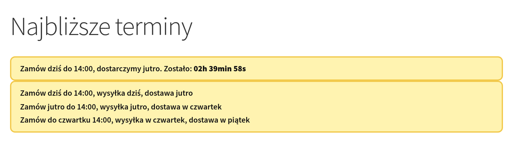
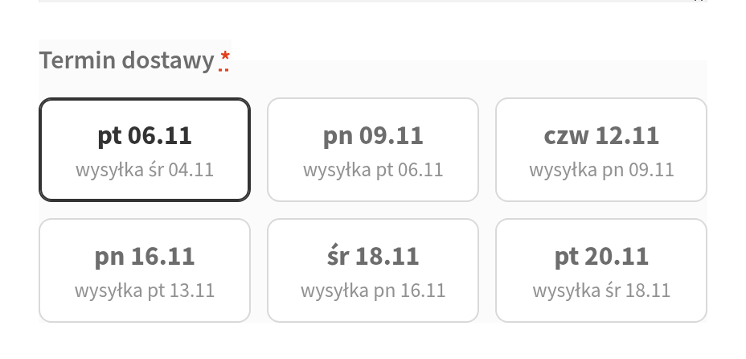
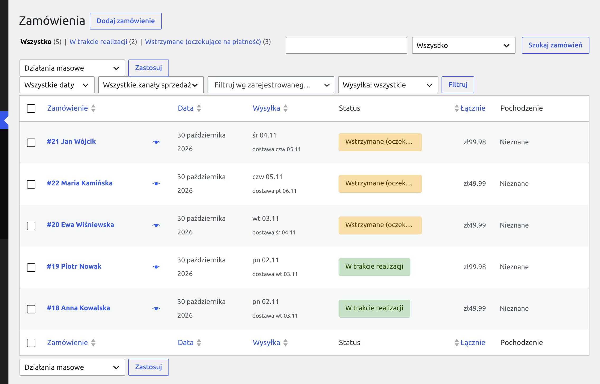
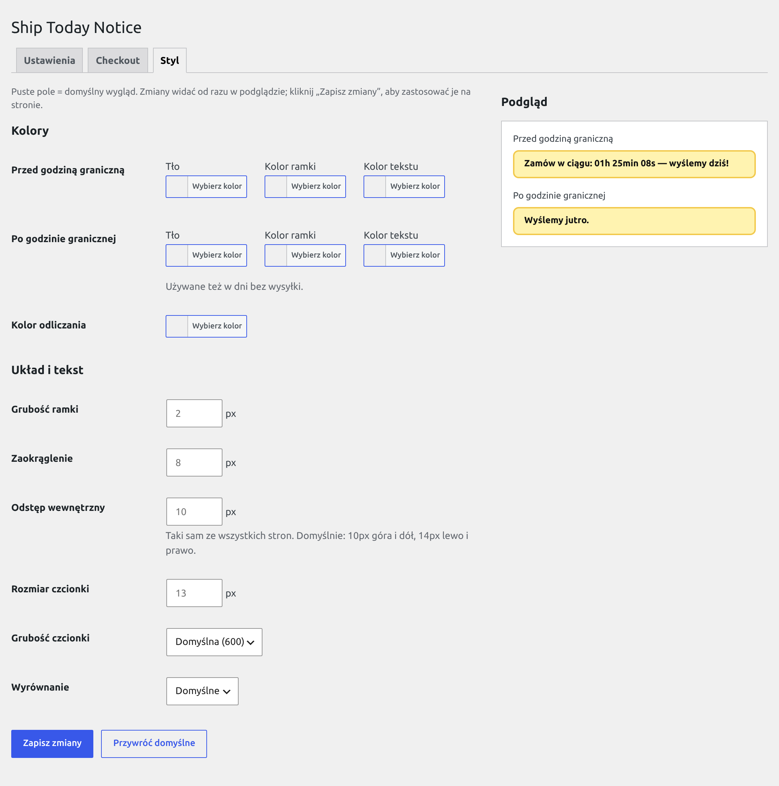
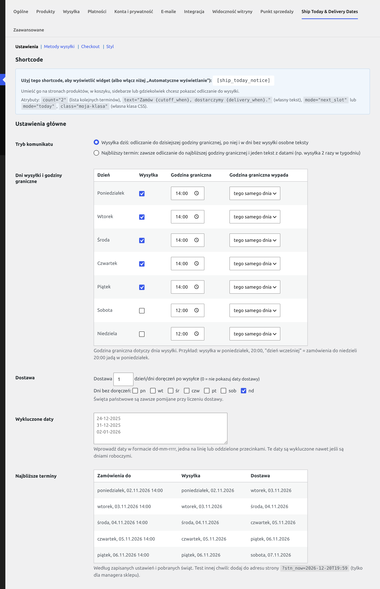
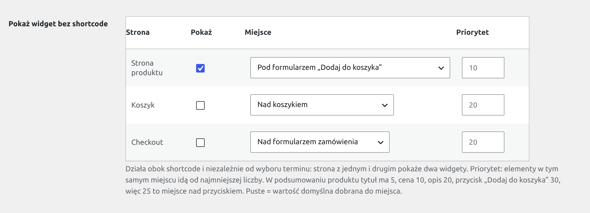
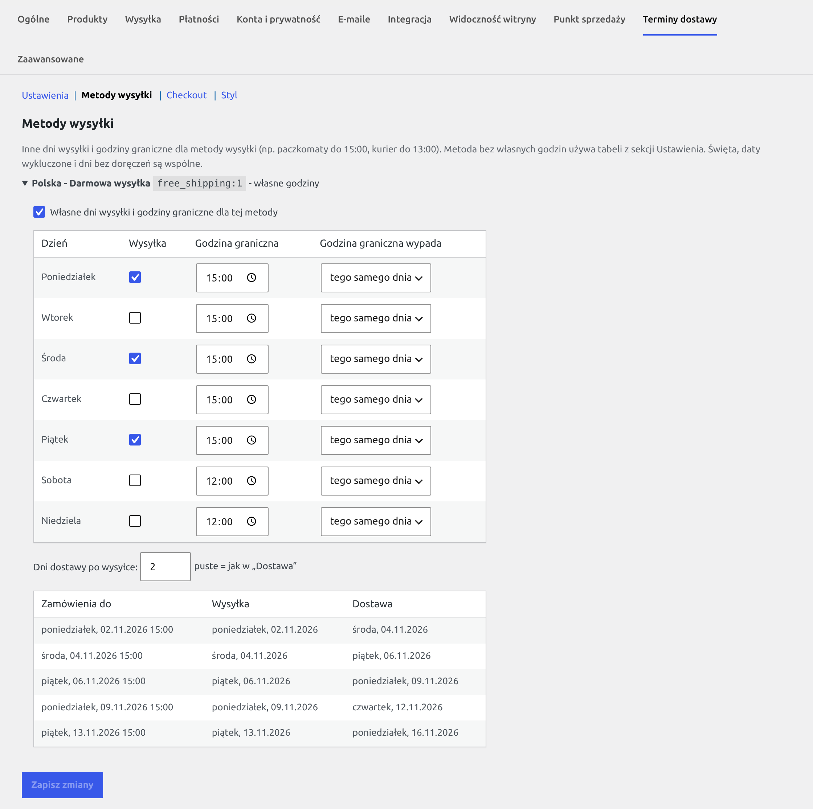
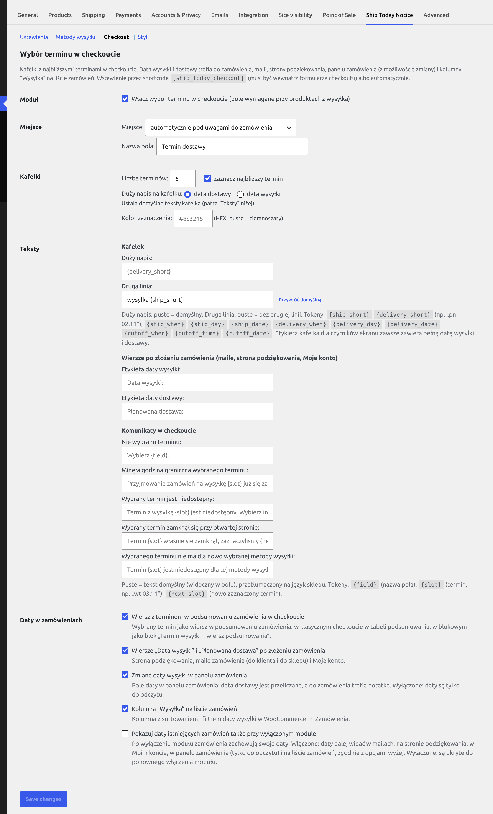

<h1 align="center">Ship Today & Delivery Dates for WooCommerce</h1>

<p align="center"><a href="README.md">English</a> | <b>Polski</b></p>

<p align="center">
  <b>„Zamów w ciągu 2h 39min - wyślemy dziś!”</b><br>
  Odliczanie do godziny granicznej, dzień wysyłki i data dostawy w sklepie WooCommerce,<br>
  plus wybór terminu dostawy w checkoucie, który trafia do zamówienia, maili i panelu.
</p>

<p align="center">
  
  
  
  
  
  
  
  
</p>

<p align="center">
  
</p>

## Po co

Klient, który nie wie, kiedy dostanie paczkę, odkłada zakup. Ta wtyczka mówi mu to wprost, w miejscu, gdzie podejmuje decyzję:

- **na karcie produktu i w koszyku** - ile zostało do godziny granicznej i kiedy paczka wyjdzie („dziś”, „jutro”, „w poniedziałek”),
- **w checkoucie** - klient wybiera termin dostawy, a sklep dostaje go w zamówieniu, mailu i na liście zamówień,
- **bez pilnowania kalendarza** - święta pobierają się same, weekendy i dni bez doręczeń są pomijane, a po godzinie granicznej
  widget sam przełącza się na kolejny termin, także na stronach z cache.

## Zrzuty

<table>
  <tr>
    <th width="50%">Kafelki z terminami w checkoucie</th>
    <th width="50%">Kolumna „Wysyłka” na liście zamówień</th>
  </tr>
  <tr>
    <td valign="top"></td>
    <td valign="top"></td>
  </tr>
</table>

**Sekcja „Styl”** - wygląd widgetu wyklikany w panelu, podgląd zmienia się na żywo:

<p align="center"></p>

<details>
<summary>Ustawienia: dni wysyłki, automatyczne wyświetlanie, metody wysyłki i Checkout</summary>

<p align="center"></p>

<p align="center"></p>

<p align="center"></p>

<p align="center"></p>

</details>

## Funkcje

**Widget `[ship_today_notice]`**
- Dwa tryby: **„wysyłka dziś”** (odliczanie do dzisiejszej godziny granicznej) i **„najbliższy termin”** (zawsze najbliższa wysyłka, np. 2 razy w tygodniu).
- Teksty z tokenami i poprawną odmianą dni: „do niedzieli 20:00”, „we wtorek”, „bis Sonntag”, „am Dienstag”.
- Lista kilku kolejnych terminów (`count="3"`), własny tekst i klasa CSS w shortcode.
- **Działa ze stron w cache** - harmonogram na 42 dni jest w HTML, przeglądarka sama liczy stan. LiteSpeed Cache czyszczony o godzinie granicznej.
- **Sekcja „Styl”** - kolory, ramka, czcionka i wyrównanie wyklikane w panelu, z podglądem na żywo, bez pisania CSS.

**Harmonogram**
- Dni wysyłki i godzina graniczna dla każdego dnia, także wypadająca wcześniej (wysyłka w poniedziałek, zamówienia do niedzieli 20:00).
- Data dostawy: N dni doręczeń po wysyłce, z pominięciem dni bez doręczeń i świąt.
- **Święta** z [OpenHolidays API](https://www.openholidaysapi.org/) dla kraju sklepu, opcjonalnie z regionem (np. `DE-BY`),
  z możliwością ignorowania wybranych. Do tego ręczna lista dat wykluczonych.

**Checkout i zamówienia** (moduł do włączenia)
- **Klasyczny checkout** - kafelki z terminami. **Checkout blokowy** - te same kafelki jako blok „Termin wysyłki”, który można przesuwać w edytorze (WooCommerce 10.1+).
- Serwer sprawdza termin przy składaniu zamówienia. Termin, który zamknął się na otwartej stronie, jest odrzucany z komunikatem.
- Data wysyłki i dostawy w mailach, na stronie podziękowania, w „Moje konto”, w panelu zamówienia (z edycją) i w kolumnie listy
  zamówień z sortowaniem i filtrem.
- **Godziny graniczne zależne od metody wysyłki** (np. paczkomat do 15:00, kurier do 13:00): kafelki i walidacja wg wybranej metody,
  zmiana metody przelicza kafelki.
- Odbiór osobisty nie wymaga daty. Zgodność z HPOS.

**Dla programistów**
- Funkcje `wc_stn_*`, filtry, akcja czyszczenia cache, `window.WcShipTodayNotice.init()`.
- Tryb testowy `?stn_now=2026-12-20T19:59` - widget, kafelki i walidacja w dowolnej chwili.
- Wszystkie teksty do tłumaczenia, w paczce pl_PL i de_DE.

## Szybki start

1. Wgraj wtyczkę do `wp-content/plugins/wc-ship-today-notice/` i aktywuj ją (wymaga aktywnego WooCommerce).
2. **WooCommerce → Ustawienia → Terminy dostawy**: zaznacz dni wysyłki i ustaw godziny graniczne.
3. Opcjonalnie ustaw **Dostawę** (ile dni doręczeń po wysyłce) i sprawdź tabelę **Najbliższe terminy**.
4. Widget od razu pokazuje się na stronach produktów, pod przyciskiem „Dodaj do koszyka”. Zmienisz to w **Automatycznym wyświetlaniu** (strona produktu, koszyk, checkout), możesz też wstawić shortcode w dowolnym miejscu:

   ```
   [ship_today_notice]
   [ship_today_notice mode="next_slot" text="Zamów {cutoff_when}, dostarczymy {delivery_when}. Zostało: {countdown}"]
   ```

5. Opcjonalnie włącz wybór terminu w sekcji **Checkout** i otwórz sekcję **Styl**.

Święta pobierają się same zaraz po aktywacji (WP-Cron). Od razu: przycisk „Fetch holidays now” na dole ustawień.

## Wymagania

| | |
|---|---|
| WordPress | 6.8+ (od 6.8 WordPress sam ładuje tłumaczenia z `languages/` wtyczki) |
| PHP | 7.4+ |
| WooCommerce | 9.4+ (sprawdzone do 11.2). Checkout blokowy z wyborem terminu: **10.1+** - na starszym blok się nie rejestruje, zamówienia przechodzą bez daty. |
| Uprawnienia | panel i zapis ustawień: `manage_woocommerce` (kierownik sklepu też może je zmieniać) |

Zgodność z HPOS i z checkoutem blokowym jest zadeklarowana (`FeaturesUtil::declare_compatibility`). Kod zamówień używa CRUD
WooCommerce i obsługuje listę zamówień HPOS oraz starą tabelę postów.

## Co działa od razu, a co trzeba włączyć

| Funkcja | Domyślnie | Gdzie się włącza | Uwagi |
|---|---|---|---|
| Widget `[ship_today_notice]` | tak, po wstawieniu shortcode | shortcode | „Wyświetlanie widgetu” = Zawsze. JS i CSS widgetu ładują się tylko na stronach z widgetem (wykrycie shortcode w treści/krótkim opisie albo render shortcode; filtr `wc_ship_today_notice_load_assets`). |
| Automatyczne wyświetlanie (bez shortcode) | **strona produktu: tak** w nowym sklepie, pod przyciskiem „Dodaj do koszyka”; koszyk i checkout: nie | Automatyczne wyświetlanie | Każda strona osobno, z miejscem i priorytetem. Sklepy po aktualizacji z wcześniejszej wersji: wszystko wyłączone. |
| Tryb komunikatu | „Wysyłka dziś” | Tryb komunikatu / atrybut `mode` | |
| Dni wysyłki | pn-pt, do 14:00 tego samego dnia | Delivery weekdays & cutoff times | sob/nd mają domyślnie 12:00, ale nie są zaznaczone. |
| Data dostawy | nie (0 dni) | Dostawa | Dni bez doręczeń domyślnie: niedziela. |
| Godziny graniczne dla metod wysyłki | nie (wszystkie metody wg tabeli globalnej) | Metody wysyłki → „Własne dni wysyłki i godziny graniczne” | Dla każdej instancji metody ze stref WooCommerce. Checkout (oba) wg wybranej metody, widget przez atrybut `method`. |
| Święta | po pobraniu | WP-Cron zaraz po aktywacji, co ok. 4 miesiące, po zmianie kraju/języka/regionu albo „Fetch holidays now” | Kraj i język: PL, bez regionu (tylko święta ogólnokrajowe). |
| Automatyczne pobieranie świąt (zapytania do OpenHolidays bez kliknięcia) | tak | Public holidays API → Automatyczne pobieranie | Wyłączone: zdarzenia cron zdjęte, święta tylko przyciskiem „Fetch holidays now”. |
| Daty wykluczone | brak | Excluded dates | |
| Tekst po godzinie granicznej / w dzień bez wysyłki | tak | checkboxy przy tekstach | Dotyczy trybu „wysyłka dziś”. |
| Sekundy w odliczaniu | tak | Countdown format | |
| Własny wygląd widgetu | nie (style z `notice.css`) | sekcja **Styl** | Puste pole = domyślny wygląd. |
| Wybór terminu w checkoucie | **nie** | Sekcja **Checkout** → Moduł | Domyślne miejsce: tylko shortcode `[ship_today_checkout]`. |
| Wiersz z terminem w podsumowaniu zamówienia (checkout) | tak, z modułem | Sekcja Checkout → Daty w zamówieniach | Oba checkouty. |
| Wiersze „Data wysyłki” / „Planowana dostawa”: maile, strona podziękowania, Moje konto | tak, z modułem | j.w. | |
| Panel zamówienia: daty | z modułem | automatycznie | Box tylko, gdy zamówienie ma daty albo można je zmienić. |
| Panel zamówienia: zmiana daty wysyłki | tak, z modułem | Daty w zamówieniach | Wyłączone: daty tylko do odczytu. |
| Kolumna „Wysyłka”, sortowanie, filtr na liście zamówień | tak, z modułem | Daty w zamówieniach | HPOS i stara tabela postów. |
| Daty istniejących zamówień przy wyłączonym module | **nie** | Daty w zamówieniach | Włączone: wiersze w mailach/podziękowaniu/Moim koncie, panel (tylko odczyt) i lista działają bez modułu, wg przełączników wyżej. |
| Czyszczenie cache o godzinie granicznej | tak, gdy aktywny LiteSpeed Cache albo podpięta akcja `wc_ship_today_notice_purge_cache` | Zaawansowane → Funkcje opcjonalne | Po zapisie ustawień cache jest czyszczony zawsze. |
| WPML | tak, gdy aktywny WPML | Zaawansowane → Funkcje opcjonalne | Cztery teksty widgetu rejestrowane przy zapisie ustawień i pokazywane w tłumaczeniu. |
| Tryb testowy `?stn_now=` | tak | Zaawansowane → Funkcje opcjonalne | Tylko dla `manage_woocommerce`. |
| Funkcje, filtry, JS API | tak | kod | |

Każdy przełącznik ma domyślnie dotychczasowe zachowanie, a wyłączony nie rejestruje swoich hooków (cron: zdarzenie nie jest
planowane albo jest zdejmowane). Gdy moduł checkoutu jest wyłączony, wtyczka nie rejestruje jego hooków. Daty zapisane wcześniej
w zamówieniach zostają w meta i są pokazywane tylko przy włączonym przełączniku „Pokazuj daty istniejących zamówień także przy
wyłączonym module”.

## Automatyczne wyświetlanie

**Ustawienia → Automatyczne wyświetlanie** pokazuje widget bez shortcode. Strona produktu, Koszyk i Checkout to niezależne wiersze: checkbox, miejsce i priorytet. W nowym sklepie widget pokazuje się na stronie produktu pod przyciskiem „Dodaj do koszyka” zaraz po aktywacji, Koszyk i Checkout są wyłączone. Sklepy aktualizujące wtyczkę z wcześniejszej wersji mają wszystko wyłączone, dopóki same tego nie włączą. Widget nie zależy od wyboru terminu w checkoucie.

| Strona | Miejsce (strony klasyczne) | Domyślny priorytet |
|---|---|---|
| Strona produktu | Pod formularzem „Dodaj do koszyka” (domyślnie) | 10 |
| | Nad formularzem „Dodaj do koszyka” | 10 |
| | W podsumowaniu produktu | 25 (tytuł 5, cena 10, opis 20, przycisk 30, meta 40) |
| Koszyk | Nad koszykiem | 20 (komunikaty 10) |
| | Nad podsumowaniem koszyka | 10 |
| | Przy przycisku „Przejdź do płatności” | 5 (przycisk 20) |
| Checkout | Nad formularzem zamówienia | 20 (komunikaty, logowanie, kupon 10) |
| | Nad podsumowaniem zamówienia | 10 |
| | Nad przyciskiem „Złóż zamówienie” | 10 |

- **Priorytet** ustala kolejność wśród elementów w tym samym hooku: mniejsza liczba idzie pierwsza. Puste pole to wartość domyślna z tabeli. Zakres 0-999.
- **Strony blokowe:** koszyk blokowy, checkout blokowy i szablon produktu z blokiem „Dodaj do koszyka” nie wywołują tych hooków. Panel je rozpoznaje i pokazuje wybór **nad albo pod blokiem**, bez priorytetu. Miejsca wewnątrz bloku WooCommerce nie są dostępne.
- Motyw blokowy z szablonem produktu `legacy-template` wywołuje hooki klasyczne, więc ma opcje klasyczne.
- Widget renderuje ten sam kod co shortcode: te same teksty, styl i widoczność. Strona, która ma też `[ship_today_notice]`, pokaże dwa widgety - to wybór sklepu.
- Klasyczny koszyk i checkout odświeżają fragmenty strony AJAX-em. Widget startuje ponownie po `updated_cart_totals`, `updated_wc_div` i `updated_checkout`, więc odliczanie działa dalej, a timery się nie mnożą.

## Dokumentacja

<details>
<summary><b>Shortcode, tryby i widoczność</b></summary>

```
[ship_today_notice]
[ship_today_notice mode="next_slot"]
[ship_today_notice count="2" text="Zamów do {cutoff_day} {cutoff_time}, a dostaniesz ją {delivery_day}."]
[ship_today_notice class="moja-klasa"]
```

| Atrybut | Domyślnie | Opis |
|---|---|---|
| `count` | `1` | Ile kolejnych terminów pokazać (1-10). Przy `count > 1` kontener ma klasę `wc-ship-today-notice--list`. Każdy termin (także pojedynczy) jest w `.wc-ship-today-notice__item`. |
| `text` | z ustawień | Własny tekst z tokenami. Zastępuje wszystkie teksty z ustawień (przed / po godzinie granicznej / dzień bez wysyłki / najbliższy termin). HTML filtrowany przez `wp_kses_post`. |
| `mode` | z ustawień | `today` albo `next_slot`. |
| `class` | - | Dodatkowe klasy CSS kontenera (oddzielone spacją). |
| `method` | - | ID instancji metody wysyłki, np. `flat_rate:3` - terminy wg jej własnych godzin (sekcja „Metody wysyłki”). Bez atrybutu, dla metody bez własnych godzin albo usuniętej - harmonogram globalny. Widget nie wykrywa metody klienta (strona może być w cache). |

Gdy „Wyświetlanie widgetu” = Wyłączony, shortcode zwraca pusty tekst, a skrypt i styl nie są ładowane.

**Tryby**

- **Wysyłka dziś** (`today`) - przed dzisiejszą godziną graniczną: „Text before cutoff” z odliczaniem. Po niej, w dzień wysyłki:
  „Text after cutoff”. W dzień bez wysyłki (dzień tygodnia, święto, data wykluczona): „Text when not a shipping day”.
- **Najbliższy termin** (`next_slot`) - zawsze odliczanie do najbliższej godziny granicznej i jeden tekst
  („Tekst w trybie najbliższy termin”). Opcja widoczności „tylko przed godziną graniczną” działa tu jak „zawsze”.

Przy `count > 1` pierwszy termin ma tekst stanu, kolejne tekst trybu „najbliższy termin”.

**Widoczność**

| Ustawienie | Działanie |
|---|---|
| Disabled | Widget i jego zasoby wyłączone. |
| Always visible | Zawsze. |
| Only before cutoff time | W trybie „wysyłka dziś” ukryty po godzinie granicznej. |
| Only N hour(s) before cutoff | Widoczny dopiero N godzin (0,5-168) przed godziną graniczną. |

Niezależnie od tego widget jest ukryty, gdy w najbliższych 42 dniach nie ma żadnego terminu.

**Odliczanie**: etykiety godzin, minut i sekund (domyślnie `h`, `min`, `s`), przełącznik sekund. Pusta etykieta = sama liczba
(np. `01:30`). Powyżej doby odliczanie pokazuje dni („1 dzień”, „3 dni”).

</details>

<details>
<summary><b>Tokeny i domyślne teksty</b></summary>

| Token | Przykład |
|---|---|
| `{countdown}` | `1 dzień 05h 12min 10s` (format w „Countdown format”) |
| `{cutoff_when}` | `dziś do 20:00` / `jutro do 20:00` / `do niedzieli 20:00` |
| `{cutoff_day}` | `niedzieli` (dopełniacz) |
| `{cutoff_time}` | `20:00` |
| `{cutoff_date}` | `25.10` |
| `{ship_when}` | `dziś` / `jutro` / `w poniedziałek` |
| `{ship_day}` | `w poniedziałek` |
| `{ship_date}` | `26.10` |
| `{delivery_when}` | `jutro` / `we wtorek` |
| `{delivery_day}` | `we wtorek` |
| `{delivery_date}` | `27.10` |

Tokeny `{delivery_*}` są puste, gdy dostawa = 0. „Dziś” i „jutro” liczy przeglądarka w strefie czasowej sklepu, więc są
poprawne także na stronie z cache. Nieznane tokeny zostają w tekście bez zmian.

Odmiana dni zależy od języka sklepu (tłumaczenia `_x()` w `.po`): po polsku „do niedzieli 20:00”, „we wtorek”,
po niemiecku „bis Sonntag 20:00”, „am Dienstag”.

Domyślne teksty (źródło po angielsku, tłumaczenie z `.po`; tekst zapisany w ustawieniach ma pierwszeństwo):

| Tekst | Źródło | pl_PL |
|---|---|---|
| Najbliższy termin | `Order {cutoff_when}, we will ship {ship_when}. Time left: {countdown}` | `Zamów {cutoff_when}, wyślemy {ship_when}. Zostało: {countdown}` |
| Przed godziną graniczną | `Order within {countdown} and we will ship today!` | `Zamów w ciągu {countdown}, a wyślemy dziś!` |
| Po godzinie granicznej | `We will ship {ship_when}.` | `Wyślemy {ship_when}.` |
| Dzień bez wysyłki | `We will ship {ship_when}.` | `Wyślemy {ship_when}.` |

W tekstach „po godzinie granicznej” i „dzień bez wysyłki” warto używać `{ship_when}` zamiast stałego „jutro”: w piątek
po godzinie granicznej albo przed świętem następna wysyłka nie jest jutro, a `{ship_when}` da „w poniedziałek”.
Do wersji 2.1.0 domyślnie było „Wyślemy jutro.” / „Wyślemy w najbliższy dzień roboczy.” - sklepy, które zapisały
ustawienia z tymi tekstami, mają je dalej i mogą je zmienić ręcznie.

</details>

<details>
<summary><b>Wygląd i sekcja „Styl”</b></summary>

WooCommerce → Ustawienia → Terminy dostawy → **Styl**: wygląd `[ship_today_notice]` bez pisania CSS, z podglądem na żywo stanów
„przed” i „po” godzinie granicznej.

| Opcja | Opis |
|-------|------|
| **Przed / po godzinie granicznej** | Tło, kolor ramki i kolor tekstu dla każdego stanu. Dzień bez wysyłki używa kolorów „po”. |
| **Kolor odliczania** | Kolor `{countdown}`. |
| **Grubość ramki, zaokrąglenie, odstęp wewnętrzny, rozmiar czcionki** | W px. Odstęp jest jeden na wszystkie boki. |
| **Grubość czcionki, wyrównanie** | 400-800; do lewej / do środka / do prawej. |

Puste pole = domyślny wygląd. „Przywróć domyślne” czyści formularz, a zapis następuje dopiero po kliknięciu „Zapisz zmiany”. Styl jest
zapisany w opcji `wc_ship_today_notice_style` i trafia na stronę jako zmienne CSS na `:root` (inline przy `notice.css`),
więc działa też ze stron w cache. Po zapisie cache jest czyszczony jak po zapisie ustawień.

Klasy stanu kontenera: `wc-ship-today-notice--before` (przed godziną graniczną i tryb „najbliższy termin”),
`--after` (po godzinie granicznej, dzień bez wysyłki), `--hidden`. Odliczanie: `.wc-ship-today-countdown`.

Zmienne CSS: `--wc-ship-today-notice-bg`, `-border`, `-color`, `-font-size`, `-before-bg`, `-before-border`, `-before-color`,
`-after-bg`, `-after-border`, `-after-color`, `-countdown-color`, `-border-width`, `-radius`, `-padding`, `-font-weight`,
`-align`, `-justify`. Można je nadpisać własnym CSS, np. na klasie z atrybutu `class`.

</details>

<details>
<summary><b>Wybór terminu w checkoucie (klasyczny, blokowy)</b></summary>

Włączenie: **WooCommerce → Ustawienia → Terminy dostawy → Checkout → Moduł**. Przy wyłączonym module sekcja pokazuje tylko ten checkbox i opcję
pokazywania dat istniejących zamówień (z przełącznikami, od których zależy). Pozostałe pola pojawiają się od razu po zaznaczeniu checkboxa,
bez zapisu, a ukryte zachowują wartości.

| Ustawienie | Domyślnie | Opis |
|---|---|---|
| Moduł | wyłączony | Pole jest wymagane, gdy koszyk wymaga wysyłki, pole było w formularzu i wybrana metoda to nie odbiór osobisty. |
| Miejsce | tylko shortcode | `[ship_today_checkout]` (musi być wewnątrz formularza checkoutu), pod uwagami do zamówienia (`woocommerce_after_order_notes`) albo nad podsumowaniem (`woocommerce_checkout_before_order_review`). |
| Nazwa pola | `Termin dostawy` | Legenda pola, wiersz w podsumowaniu, komunikat walidacji. |
| Liczba terminów | 6 | 1-12 kafelków. |
| Zaznacz najbliższy termin | tak | |
| Duży napis na kafelku | data dostawy | Albo data wysyłki. Bez ustawionej dostawy zawsze data wysyłki. Ustala **domyślne** teksty kafelka (pola „Teksty” niżej). |
| Kolor zaznaczenia | ciemnoszary | HEX albo zmienna CSS `--wc-stn-accent`. |
| Teksty → Kafelek | jak wyżej | „Duży napis” (puste = domyślny) i „Druga linia” (pole ma wpisaną domyślną; **puste = bez drugiej linii**, przycisk „Przywróć domyślną”). Tokeny niżej. |
| Teksty → Wiersze po złożeniu zamówienia | `Data wysyłki:` / `Planowana dostawa:` | Etykiety w mailach, na stronie podziękowania i w Moim koncie. Puste = domyślne (przetłumaczone). Oba wiersze wyłącza przełącznik w „Daty w zamówieniach”. |
| Teksty → Komunikaty | jak dotąd | „Nie wybrano terminu” (`{field}`), „Minęła godzina graniczna” i „Termin niedostępny” (`{slot}`), „Termin zamknął się przy otwartej stronie” (`{slot}`, `{next_slot}`). Puste = domyślny (pole pokazuje go w podpowiedzi). |

**Teksty kafelka.** Tokeny jak w widgecie, liczone dla terminu z kafelka: `{ship_when}`, `{ship_day}`, `{ship_date}`, `{delivery_when}`,
`{delivery_day}`, `{delivery_date}`, `{cutoff_when}`, `{cutoff_time}`, `{cutoff_date}` oraz krótkie formy z kafelka `{ship_short}`
i `{delivery_short}` (np. „pn 02.11”). Domyślne teksty to szablony z tych tokenów: „Duży napis = data dostawy” →
`{delivery_short}` / `wysyłka {ship_short}`, „data wysyłki” → `{ship_short}` / `dostawa {delivery_short}`, bez dostawy →
`{ship_short}` / `wysyłka` (przetłumaczone, np. de `Versand {ship_short}`). Przykład: tylko pogrubiona data dostawy -
„Duży napis” pusty, „Druga linia” pusta. Tokeny `{delivery_*}` są puste, gdy termin nie ma daty dostawy.
„Dziś/jutro” w `{*_when}` liczy serwer przy otwarciu strony (checkout nie jest cache'owany); kafelki dokładane po upływie godziny
granicznej mają teksty z tej samej chwili, więc tylko strona otwarta przez północ pokazałaby nieaktualne „dziś/jutro”.
Etykieta kafelka dla czytników ekranu (`aria-label`) zawsze zawiera pełną datę wysyłki, dostawy i godzinę graniczną.
W komunikatach `{slot}` / `{next_slot}` to termin w formie domyślnego dużego napisu, niezależnie od własnych tekstów kafelka.

Własne teksty (kafelek, etykiety, komunikaty) przechodzą przez WPML jak teksty widgetu (przełącznik „WPML”). Puste pola biorą
tekst z tłumaczeń wtyczki, więc sklep pl/de bez zmian dostaje tłumaczenie.

> **Uwaga:** przy miejscu „tylko shortcode” trzeba wstawić `[ship_today_checkout]` do formularza checkoutu. Bez tego
> (albo z shortcode poza formularzem) pole się nie pokaże, a zamówienia będą składane bez daty wysyłki. Panel pokazuje
> przy tym ustawieniu ostrzeżenie.

**Klasyczny checkout**

- Kafelki z najbliższymi terminami. Gdy godzina graniczna minie na otwartej stronie, kafelek znika, dochodzi kolejny,
  a zaznaczenie przechodzi na najbliższy z komunikatem. Zmiana kafelka odświeża podsumowanie (`update_checkout`).
- Wiersz z terminem w tabeli podsumowania zamówienia.
- Przy składaniu zamówienia serwer sprawdza termin jeszcze raz (`woocommerce_after_checkout_validation`). Termin, którego
  godzina graniczna minęła, jest odrzucany z komunikatem.
- Data jest wymagana tylko wtedy, gdy pole było w wysłanym formularzu (ukryte pole `wc_stn_rendered`). Brak shortcode
  albo shortcode poza formularzem nie blokuje zamówień.
- Odbiór osobisty: gdy wszystkie wybrane metody wysyłki to odbiór (`local_pickup`, `pickup_location`, filtr
  `woocommerce_local_pickup_methods`), data nie jest wymagana. Kafelki zostają: wybrany termin zapisze się w zamówieniu,
  brak wyboru też przejdzie.
- Zapis w zamówieniu przez CRUD (`woocommerce_checkout_create_order`) - działa z HPOS i starą tabelą postów.
- Wiersze „Data wysyłki” i „Planowana dostawa” na stronie podziękowania, w mailach (klient i admin) i w Moje konto
  (`woocommerce_get_order_item_totals`).
- Panel zamówienia: daty i pole „Zmień datę wysyłki” (dostawa przeliczana automatycznie, notatka w zamówieniu z nazwą użytkownika).
  Puste pole usuwa daty. Błędna data (np. 31.02) nie jest zapisywana, panel pokazuje komunikat. Klient nie dostaje powiadomienia o zmianie.
- Lista zamówień (HPOS i stara): kolumna „Wysyłka” za datą zamówienia, sortowanie i filtr „Wysyłka: dd.mm.rrrr”
  (dni wysyłki od 14 dni wstecz do 31 dni w przód). Sortowanie pokazuje tylko zamówienia z datą z tego modułu.

**Checkout blokowy**

Wymaga WooCommerce 10.1+ (sprawdzone na 11.3). Na starszej wersji blok się nie rejestruje.

W checkoucie blokowym termin wybiera się z tych samych kafelków co w klasycznym, w bloku **„Ship date”** (`wc-stn/ship-date`,
blok wewnętrzny formularza checkoutu, rodzic `woocommerce/checkout-fields-block`):

- **Wstawienie:** przy pierwszej wizycie w panelu po włączeniu modułu wtyczka raz wstawia blok do strony zamówienia
  (pod „Metody wysyłki”, a gdy ich nie ma - przed „Płatnością”). Potem blok należy do sklepu: można go **przesunąć** w edytorze
  strony zamówienia, **usunąć** i dodać ponownie z insertera (szukaj „Termin wysyłki”, w angielskim panelu „Ship date”). Usuniętego wtyczka nie wstawia drugi raz.
  Sekcja **Checkout** pokazuje, czy blok jest na stronie zamówienia. Checkout w szablonie motywu
  (Edytor witryny) nie jest zmieniany automatycznie - tam blok trzeba dodać ręcznie.
- **Bez bloku** klient nie wybiera terminu, a zamówienia przechodzą bez daty (bez blokowania sprzedaży). Panel pokazuje wtedy
  powiadomienie (użytkownikom z `manage_woocommerce`, do zamknięcia - wraca, jeśli zmieni się strona zamówienia).
- **Aktualizacja z 2.2.0** (tam był select): blok wstawia się też w `maybe_upgrade()`, przy pierwszym wejściu do panelu po aktualizacji.
- Ustawienia „Liczba terminów”, „Zaznacz najbliższy termin”, „Duży napis na kafelku”, „Kolor zaznaczenia”, „Nazwa pola”
  i „Teksty” (kafelek, komunikaty) działają jak w klasycznym checkoucie. „Miejsce” dotyczy tylko klasycznego. Blok jest widoczny tylko, gdy koszyk wymaga wysyłki
  i nie wybrano odbioru osobistego.
- Gdy godzina graniczna minie na otwartej stronie, kafelek znika, dochodzi kolejny, a zaznaczenie przechodzi na najbliższy z komunikatem.
- Termin idzie do Store API jako `extensions.wc-stn.ship_date` (z `rendered: true`, gdy blok był widoczny). Przy składaniu
  zamówienia (`woocommerce_store_api_checkout_update_order_from_request`) serwer wymaga daty tylko przy `rendered`, odrzuca brak
  daty („Wybierz termin dostawy.”) i termin spoza aktualnych („Przyjmowanie zamówień na wysyłkę … już się zakończyło. …”)
  i zapisuje te same meta co klasyczny checkout, więc maile, strona podziękowania, panel i lista zamówień działają tak samo.
- JS bez kroku build (`assets/blocks/ship-date/`: `block.json`, `editor.js`, `frontend.js`), wygląd z `checkout.css`.
- **Wiersz w podsumowaniu zamówienia** - blok „Termin wysyłki: wiersz podsumowania” (`wc-stn/ship-date-row`, w podsumowaniu sum,
  rodzic `woocommerce/checkout-order-summary-totals-block`) pokazuje wybrany termin tak jak wiersz w klasycznym checkoucie
  („Termin dostawy: Wysyłka pn 02.11 / dostawa wt 03.11”, etykieta = „Nazwa pola”). Zmienia się od razu po wyborze kafelka
  i po upływie godziny granicznej. Wtyczka wstawia go raz pod wierszem wysyłki (jak blok kafelków, osobny znacznik
  `wc_ship_today_notice_row_inserted`); można go przesunąć albo usunąć. Strona ze starszym układem podsumowania (wiersze sum
  bezpośrednio w `checkout-order-summary-block`, bez `checkout-order-summary-totals-block`) jest przy tym migrowana do nowego
  układu: edytor WooCommerce robi to sam przy otwarciu strony i gubi przy tym nieznane bloki, więc wiersz musi być już w bloku sum.
  Gdy wstawienie się nie uda, ustawienia (sekcja checkoutu) pokazują status na czerwono, a wtyczka spróbuje ponownie przy
  kolejnym wejściu do panelu. Wiersza nie ma, gdy przełącznik „Wiersz z terminem
  w podsumowaniu zamówienia” jest wyłączony, gdy na stronie nie ma bloku kafelków albo gdy termin nie jest wybrany.
  Oba bloki dzielą wybrany termin przez store `wp.data` `wc-stn/ship-date`.

**Meta zamówień**

| Klucz | Wartość |
|---|---|
| `_wc_stn_ship_date` | data wysyłki `Y-m-d` |
| `_wc_stn_delivery_date` | data dostawy `Y-m-d` albo pusty tekst |
| `_wc_stn_cutoff` | znacznik czasu godziny granicznej wybranego terminu (usuwany przy ręcznej zmianie daty) |

</details>

<details>
<summary><b>Godziny graniczne dla metod wysyłki</b></summary>

WooCommerce → Ustawienia → Terminy dostawy → sekcja **Metody wysyłki**: lista wszystkich metod ze stref wysyłki
WooCommerce (także „Pozostałe regiony” i metody z wtyczek, np. paczkomaty), każda jako instancja `metoda:instancja`
(np. `flat_rate:3`), więc różne strefy/kraje mogą mieć różne godziny.

- „Własne dni wysyłki i godziny graniczne dla tej metody” → ta sama tabela co globalna (dni wysyłki, godzina graniczna,
  przesunięcie) i opcjonalnie liczba dni dostawy (puste = jak w „Dostawa”). Pod spodem podgląd 5 najbliższych terminów metody.
- Metoda bez własnych godzin, z odznaczonym checkboxem albo usunięta w WooCommerce → harmonogram globalny.
- Wspólne dla wszystkich metod: święta, daty wykluczone, dni bez doręczeń.
- Zapis w opcji `wc_ship_today_notice_method_schedules` (`["flat_rate:3" => [enabled, delivery_days, cutoff_times,
  cutoff_offsets, delivery_offset]]`). Bez tej opcji wtyczka działa dokładnie jak wcześniej.

Działanie:
- **Klasyczny checkout:** kafelki dla wybranej metody (pierwsza paczka). Po zmianie metody `update_checkout` odsyła terminy
  nowej metody (fragment `#wc-stn-checkout-data`), kafelki się przeliczają. Zaznaczenie zostaje, jeśli ten sam widoczny termin
  (duży napis kafelka) albo ta sama data wysyłki istnieje dla nowej metody, inaczej przechodzi na najbliższy z komunikatem
  (Teksty → „Wybranego terminu nie ma dla nowo wybranej metody wysyłki”, tokeny `{slot}`, `{next_slot}`). Wiersz w podsumowaniu,
  walidacja i zapis w zamówieniu - wg wybranej metody.
- **Checkout blokowy:** blok „Termin wysyłki” dostaje terminy dla każdej metody z własnymi godzinami i wybiera je wg stawki
  zaznaczonej w koszyku (`wc/store/cart`). Zmiana metody działa jak w klasycznym. Walidacja w Store API wg wybranej metody.
- **Odbiór osobisty:** bez zmian, data niewymagana.
- **Panel zamówienia:** zmiana daty wysyłki liczy dostawę wg metody wysyłki zamówienia.
- **Widget:** atrybut `method="flat_rate:3"` (jedna metoda). Czyszczenie cache (LiteSpeed / akcja) - o najbliższej godzinie
  granicznej ze wszystkich harmonogramów.
- Tryb testowy `?stn_now=` działa przy otwarciu strony, ale nie w AJAX-ie przeliczania checkoutu (`update_order_review`) -
  po zmianie metody kafelki liczą się od prawdziwego „teraz”.

</details>

<details>
<summary><b>Święta</b></summary>

Źródło: [OpenHolidays API](https://www.openholidaysapi.org/), bieżący i następny rok, dla kraju i języka z ustawień
(`[A-Z]{2}`; błędny kod nie jest zapisywany, zostaje poprzedni z komunikatem).

- **Kiedy pobierane:** zaraz po aktywacji (pojedyncze zdarzenie WP-Cron), co ok. 4 miesiące, od razu po zapisie ustawień ze zmienionym
  krajem, językiem albo regionem, przyciskiem „Fetch holidays now”. Gdy pobranie z crona się nie uda (sieć, API), ponowna próba za 6 h.
- **Pusta albo błędna odpowiedź** (brak sieci, błąd HTTP, pusta lista, nie-JSON) nie kasuje zapisanych świąt danego roku.
- **Święta regionalne** (`nationwide: false` w API, np. Boże Ciało w części landów DE) są pomijane. Pole **Region** (kod ISO 3166-2,
  np. `DE-BY`) dokłada święta tego regionu i regionów nadrzędnych (region `DE-BY-AU` dostaje święta `DE-BY` i `DE-BY-AU`, region
  `DE-BY` nie dostaje świąt samego Augsburga). Kody: `https://openholidaysapi.org/Subdivisions?countryIsoCode=DE`. Region z innego
  kraju jest czyszczony z komunikatem. Dla PL API nie zwraca świąt regionalnych, więc nic się nie zmienia.
- **Święta wielodniowe** (`startDate`..`endDate`, np. Nowy Rok 1-2.01 w SI, RO, RS) są zapisywane jako kolejne dni.
- Pojedyncze święta można ignorować (wysyłka możliwa), do tego ręczna lista dat wykluczonych.

Do API idzie tylko kod kraju, kod języka i zakres dat - bez danych klientów (szczegóły w sekcji „External services” w `readme.txt`).

</details>

<details>
<summary><b>API dla programistów: funkcje, filtry, akcje, JS</b></summary>

**Funkcje PHP** (daty jako `Y-m-d` w strefie czasowej sklepu)

| Funkcja | Zwraca |
|---|---|
| `wc_stn_get_slots( $count = 1, $now = null, $method = null )` | najbliższe terminy, których godzina graniczna jeszcze nie minęła: tablica `['cutoff' => DateTimeImmutable, 'ship' => DateTimeImmutable, 'delivery' => ?DateTimeImmutable]`. `$now` przyjmuje `DateTime` lub `DateTimeImmutable`. `$method` = ID instancji metody wysyłki (`flat_rate:3`), `null` = globalny. |
| `wc_stn_delivery_for_ship_date( $ship_ymd, $method = null )` | data dostawy dla daty wysyłki (`Y-m-d` lub `Ymd`) albo `null`, gdy dostawa = 0 lub data jest błędna |
| `wc_stn_is_blocked_date( $ymd )` | czy data to nieignorowane święto albo data wykluczona (bez względu na dzień tygodnia); `false` dla błędnej daty |
| `wc_stn_is_shipping_day( $ymd, $method = null )` | czy to dzień wysyłki (dzień tygodnia z ustawień, nie święto, nie data wykluczona); `false` dla błędnej daty |

**Filtry**

| Filtr | Argumenty | Do czego |
|---|---|---|
| `wc_ship_today_notice_now` | `DateTimeImmutable $now` | Podmiana „teraz” (używa go tryb testowy). |
| `wc_ship_today_notice_is_shipping_day` | `bool $is`, `string $ymd`, `?string $method` | Własne dni wysyłki / blokady. |
| `wc_ship_today_notice_cutoff_time` | `string $time` (`H:i`), `int $weekday` (1 = pn), `string $ship_ymd`, `?string $method` | Inna godzina graniczna dla konkretnego dnia. |
| `wc_ship_today_notice_slots` | `array $slots`, `int $count`, `DateTimeImmutable $now`, `?string $method` | Zmiana listy terminów (widget, checkout, walidacja). |
| `wc_ship_today_notice_text` | `string $text`, `string $state` (`next`, `before`, `after`, `not_shipping`), `string $mode`, `?string $method` | Tekst widgetu przed wstawieniem tokenów. |
| `wc_ship_today_notice_load_assets` | `bool $load` (wykryty shortcode albo Automatyczne wyświetlanie na tej stronie) | `true` = JS i CSS widgetu w `<head>` na tej stronie. Potrzebne, gdy widget przychodzi w treści doładowanej AJAX-em (popup, PJAX). |

`$method` (ostatni argument, opcjonalny - stare callbacki działają bez zmian) to ID instancji metody wysyłki (`flat_rate:3`),
dla której liczony jest termin, także gdy metoda nie ma własnych godzin, albo `null` dla harmonogramu globalnego.

JS i CSS widgetu ładują się tylko tam, gdzie jest widget:
- shortcode w treści albo krótkim opisie (np. produktu) wpisów z głównego zapytania, także w bloku „Shortcode” (`core/shortcode`)
  → CSS w `<head>`, JS w stopce;
- w każdym innym miejscu, które renderuje shortcode po stronie serwera (widget sidebara, szablon, page builder) → przy renderze:
  CSS wypisany tuż przed widgetem (bez chwili bez stylu), JS w stopce;
- styl z sekcji „Styl” zawsze idzie razem z `notice.css`.

Wykrycie patrzy na wpisy z głównego zapytania, więc np. lista produktów, z których któryś ma shortcode w krótkim opisie, też
załaduje assety, nawet jeśli lista go nie wyświetla.

**Akcje**

| Akcja | Kiedy |
|---|---|
| `wc_ship_today_notice_purge_cache` | O godzinie granicznej (+5 s, WP-Cron) i po zapisie ustawień, razem z `litespeed_purge_all`. Podepnij czyszczenie innego cache. |

Zdarzenia WP-Cron: `wc_ship_today_notice_cron_sync_holidays` (święta, co ok. 4 miesiące, plus pojedyncze zdarzenia po aktywacji
i przy ponownej próbie) i `wc_ship_today_notice_cron_purge_cache` (pojedyncze zdarzenie na najbliższą godzinę graniczną, planowane
tylko przy aktywnym LiteSpeed Cache albo podpiętej akcji `wc_ship_today_notice_purge_cache`; bez nich zdejmowane).

**JS**

```js
window.WcShipTodayNotice.init(root); // inicjuje widgety w treści doładowanej AJAX-em (popupy, PJAX); root domyślnie document
```

Widget czyta konfigurację z atrybutu `data-stn`. Każdy element jest inicjowany tylko raz. Jeśli na stronie nie ma widgetu w HTML
(cała treść przychodzi AJAX-em), `notice.js` się nie załaduje - włącz go filtrem:

```php
add_filter('wc_ship_today_notice_load_assets', '__return_true'); // albo warunek, np. is_front_page()
```

**Tryb testowy**: użytkownik z `manage_woocommerce` może dodać do adresu dowolnej strony `?stn_now=2026-12-20T19:59`. „Teraz”
zmienia się wtedy w PHP i w JS (widget, kafelki, walidacja checkoutu). Data jest interpretowana w strefie czasowej sklepu.

</details>

<details>
<summary><b>Tłumaczenia i WPML</b></summary>

- Text domain: `wc-ship-today-notice`. Pliki `.pot`, `pl_PL` i `de_DE` w `languages/`. Plik z `wp-content/languages/plugins/`
  ma pierwszeństwo.
- Tłumaczone są wszystkie teksty wtyczki: panel, domyślne teksty widgetu, dni tygodnia w formach zależnych od miejsca
  w zdaniu (`_x()` z kontekstem: nazwa, „do ...”, „w/we ...”, skrót), „dziś”/„jutro”, kafelki, komunikaty walidacji,
  wiersze w mailach, panelu i na liście zamówień. Teksty dla JS (`notice.js`, `checkout.js`) przychodzą z PHP po tłumaczeniu.
- Uproszczenie: odliczanie dostaje z `_n()` formę dla 1 i dla 2 dni („1 dzień”, „N dni”); języki z inną formą dla 5+
  dni pokażą formę dla 2.
- Nazwa pola w komunikacie „Wybierz termin dostawy.” jest po polsku zamieniana na małe litery; tłumaczenie tekstu `yes`
  z kontekstem „Lowercase the field label...” na `no` to wyłącza (de_DE: „Bitte Liefertermin auswählen.”).
- WPML: teksty widgetu (`text_next_slot`, `text_before_cutoff`, `text_after_cutoff`, `text_not_shipping_day`) są rejestrowane
  jako stringi w domenie `wc-ship-today-notice` przy zapisie ustawień.

</details>

<details>
<summary><b>Dane w bazie i deinstalacja</b></summary>

- Opcja `wc_ship_today_notice_options` - wszystkie ustawienia (tablica).
- Opcja `wc_ship_today_notice_style` - ustawienia sekcji „Styl” (tablica, puste wartości = domyślne).
- Opcja `wc_ship_today_notice_version` - wersja do migracji (1.x → 2.0: ignorowane święta z ID na daty).
- Opcja `wc_ship_today_notice_method_schedules` - godziny graniczne dla metod wysyłki (klucz: ID instancji metody).
- Tabela `{prefix}wc_ship_today_notice_holidays` - pobrane święta.

Dezaktywacja usuwa wszystkie zdarzenia cron wtyczki (`wp_clear_scheduled_hook`). Usunięcie wtyczki (`uninstall.php`) kasuje opcje wtyczki,
tabelę świąt i zdarzenia cron (także na każdej stronie multisite). Meta zamówień (`_wc_stn_*`) zostają w zamówieniach.

</details>

## Rozwój

```bash
scripts/lint.sh            # php -l + node --check, bez WordPressa
npm install                # pierwszy raz: @wordpress/env (wymaga Dockera i Node 20+)
npm run env:start          # http://localhost:8894, admin / password
npm run env:seed           # produkt, klasyczny checkout, wysyłka PL, płatność przy odbiorze, święta PL
npm run test:schedule      # tabela przypadków silnika (tests/cli-schedule-test.php)
scripts/build-zip.sh       # build/ship-today-delivery-dates.zip bez plików deweloperskich (.distignore)
npm run env:destroy        # usunięcie środowiska
```

`tests/cli-schedule-test.php` to tabela przypadków silnika: godziny graniczne, święta, regiony, przełom roku, zmiana czasu,
teksty, API. Wymaga pobranych świąt PL na lata 2026-2027 (`env:seed`). Nie zmienia zapisanych ustawień.

<details>
<summary><b>Struktura plików</b></summary>

```
wc-ship-today-notice/
├── wc-ship-today-notice.php        # Główny plik: panel, shortcode widgetu, święta, cron, cache, tryb testowy, WPML
├── uninstall.php                   # Usuwanie: opcje, tabela świąt, cron (meta zamówień zostają)
├── readme.txt                      # Readme w formacie WordPress.org (po angielsku)
├── index.php
├── includes/
│   ├── class-wc-stn-schedule.php   # Silnik terminów (dni wysyłki, godzina graniczna, dostawa, tokeny, odmiana dni)
│   ├── class-wc-stn-checkout.php   # Klasyczny checkout, zamówienia, lista zamówień
│   ├── class-wc-stn-checkout-blocks.php  # Checkout blokowy: blok "Ship date", wstawienie do strony, Store API
│   ├── class-wc-stn-auto-placement.php  # Automatyczne wyświetlanie: hooki, miejsca przy blokach
│   ├── class-wc-stn-blocks-integration.php  # Skrypt i dane bloku dla checkoutu blokowego (IntegrationInterface)
│   └── functions.php               # Publiczne API wc_stn_*
├── assets/
│   ├── css/notice.css              # Widget
│   ├── css/checkout.css            # Kafelki w checkoucie
│   ├── css/settings.css            # Panel: układ pól w zakładce ustawień WooCommerce
│   ├── js/notice.js                # Widget: stany, odliczanie, przełączanie terminów
│   ├── js/checkout.js              # Kafelki: wybór, upływ godziny granicznej
│   ├── js/style-preview.js         # Podgląd na żywo w sekcji "Styl"
│   ├── js/checkout-settings.js     # Sekcja Checkout: pokazywanie i ukrywanie pól modułu
│   ├── blocks/ship-date/           # Bloki checkoutu blokowego: kafelki i wiersz podsumowania (editor.js, frontend.js; bez kroku build)
│   └── blocks/ship-date-row/       # block.json wiersza w podsumowaniu zamówienia
├── languages/                      # .pot, pl_PL i de_DE (.po + .mo)
├── tests/cli-schedule-test.php     # Tabela przypadków silnika (wp eval-file)
├── scripts/                        # lint.sh, build-zip.sh, env/ (seed i start wp-env)
├── .wordpress-org/                 # Zrzuty ekranu: angielskie, polskie w pl/ (poza paczką)
├── .wp-env.json, package.json      # Lokalne środowisko (poza paczką)
└── .distignore                     # Co nie trafia do paczki
```


</details>

## Wsparcie

- **Bezpłatnie:** błędy wtyczki i pytania o funkcje przez [GitHub Issues](https://github.com/msiemieniukmorawski/ship-today-delivery-dates/issues), bez gwarantowanego czasu odpowiedzi.
- **Płatnie:** konfiguracja pod sklep, dopasowanie do motywu, integracje z przewoźnikami i zmiany na zamówienie: [ms-m.pl](https://ms-m.pl).

## Changelog

### 2.6.2 (31.10.2026)

- Domyślne teksty i etykiety panelu nie mają już półpauz ani pauz. Domyślny tekst przed godziną graniczną to teraz „Zamów w ciągu {countdown}, a wyślemy dziś!”.
- Zakładka w WooCommerce → Ustawienia nazywa się teraz **Terminy dostawy** (adres bez zmian). Pełna nazwa wtyczki zostaje na liście wtyczek.
- Usunięte nieużywane stałe `WC_STN_Schedule::DAY_*` i automatyczna zamiana domyślnych tekstów sprzed 2.2.0: sklep aktualizowany z takiej wersji zachowuje „Wyślemy jutro.”, dopóki nie zmieni tekstu.

### 2.6.1 (31.10.2026)

- Nowa nazwa: **Ship Today & Delivery Dates for WooCommerce** (w panelu: Ship Today & Delivery Dates). Text domain, nazwy opcji, hooki i shortcode'y bez zmian.
- Paczka to teraz `build/ship-today-delivery-dates.zip`.

### 2.6.0 (31.10.2026)

- Ustawienia wtyczki przeniesione do zakładki **Ship Today Notice** w WooCommerce → Ustawienia, tuż przed „Zaawansowane”, z sekcjami Ustawienia, Metody wysyłki, Checkout i Styl.
  Pozycji w bocznym menu WooCommerce już nie ma, stare adresy przekierowują w nowe miejsce. Na liście wtyczek doszedł link „Ustawienia”.
- Godziny graniczne dla metod wysyłki przeniesione do osobnej sekcji **Metody wysyłki**.

### 2.5.0 (31.10.2026)

- Nowa zakładka **Checkout** obok „Ustawień” i „Stylu” z całą sekcją „Wybór terminu w checkoucie”. Przy wyłączonym module widać tylko
  checkbox modułu i opcję „daty istniejących zamówień”; pozostałe pola pojawiają się od razu po zaznaczeniu checkboxa, bez zapisu.
- Zapis jednej zakładki nie zmienia pól drugiej. Zapis opcji z kodu zmienia tylko podane klucze.
- Usunięto obsługę Iconic Delivery Slots.
- Powiadomienie o braku bloku „Termin wysyłki” pojawia się też w zakładkach Ustawienia i Styl (status bloku jest tylko w zakładce Checkout).
- **Automatyczne wyświetlanie:** widget na stronie produktu, w koszyku i checkoucie bez shortcode, z miejscem i priorytetem dla każdej strony. Koszyk i checkout blokowy oraz blokowy szablon produktu: nad albo pod blokiem. Nowe sklepy: włączone na stronie produktu, pod przyciskiem „Dodaj do koszyka”. Sklepy po aktualizacji: wyłączone, dopóki same nie włączą.
- JS widgetu działa dalej, gdy klasyczny koszyk albo checkout podmieni go AJAX-em, a zegar usuniętego widgetu się zatrzymuje.

### 2.4.1 (31.10.2026)

- Nazwa wtyczki w nagłówku, `readme.txt` i panelu po polsku: „WooCommerce Ship Today Notice” / „Ship Today Notice” (wcześniej „Powiadomienie o wysyłce dziś”).

### 2.4.0 (30.10.2026)

**Nowe**
- **Godziny graniczne zależne od metody wysyłki:** sekcja „Metody wysyłki” w ustawieniach (lista stref → metod WooCommerce,
  własne dni wysyłki, godziny graniczne, przesunięcia i liczba dni dostawy, podgląd terminów). Klasyczny i blokowy checkout:
  kafelki, walidacja i zapis wg wybranej metody, zmiana metody przelicza kafelki (zaznaczenie zostaje albo przechodzi
  z nowym komunikatem). Panel zamówienia liczy dostawę wg metody zamówienia. Widget: atrybut `method`.
- API: `wc_stn_get_slots()`, `wc_stn_delivery_for_ship_date()`, `wc_stn_is_shipping_day()` z opcjonalnym `$method`; filtry
  terminów i tekstu dostają ID metody jako ostatni argument (zgodnie wstecz).
- Checkout blokowy: wiersz z wybranym terminem w **podsumowaniu zamówienia** (blok „Termin wysyłki: wiersz podsumowania”),
  jak w klasycznym checkoucie, aktualizowany na żywo. Wstawiany raz pod wierszem wysyłki (przy wejściu do panelu albo aktualizacji),
  przesuwalny i usuwalny w edytorze. Działa z przełącznikiem „Wiersz z terminem w podsumowaniu zamówienia”.
  Na stronach zamówienia ze starszym układem podsumowania (bez bloku sum `checkout-order-summary-totals-block`, z wcześniejszych
  wersji WooCommerce) wtyczka przy wstawieniu zamyka wiersze sum w tym bloku - tak jak robi to edytor WooCommerce przy otwarciu strony.
  Gdy wiersza nie da się wstawić (np. strona bez podsumowania), ustawienia pokazują to na czerwono.

Bez ustawień dla metod wysyłki wszystko działa jak w 2.3.0.

### 2.3.0 (30.10.2026)

> **Przy aktualizacji z 2.2.0 (checkout blokowy):** pole wyboru terminu (select w „Dodatkowych informacjach”) zastępuje blok
> „Termin wysyłki” z kafelkami. Przy pierwszym wejściu do panelu po aktualizacji wtyczka sama wstawia blok do strony zamówienia
> pod „Metody wysyłki” (raz; potem można go przesunąć albo usunąć). Do tej chwili checkout blokowy nie ma wyboru terminu, ale
> zamówienia przechodzą normalnie. Jeśli checkout jest w szablonie motywu (Edytor witryny), panel pokaże powiadomienie - blok
> trzeba dodać ręcznie. Zamówienia złożone z polem select mają te same daty w mailach, panelu i na liście zamówień.

**Nowe**
- **Teksty kafelków, wierszy i komunikatów w ustawieniach** (zakładka Checkout → Teksty): duży napis i druga linia
  kafelka z tokenami (dotychczasowe z widgetu + `{ship_short}`, `{delivery_short}`; pusta druga linia = ukryta), etykiety
  „Data wysyłki” / „Planowana dostawa”, cztery komunikaty checkoutu z `{field}` / `{slot}` / `{next_slot}`. Klasyczny i blokowy
  checkout, maile, WPML. Puste pola = dotychczasowe przetłumaczone teksty (bez zmian dla sklepów, które nic nie ustawią).
- Checkout blokowy: wybór terminu z **kafelków** jak w klasycznym checkoucie, w bloku „Termin wysyłki” (`wc-stn/ship-date`),
  który można przesuwać, usuwać i dodawać ponownie w edytorze strony zamówienia. Upływ godziny granicznej na otwartej stronie
  przełącza zaznaczenie z komunikatem. Działają ustawienia „Liczba terminów”, „Zaznacz najbliższy”, „Duży napis”, „Kolor zaznaczenia”.
- Powiadomienie w panelu (do zamknięcia), gdy checkout blokowy nie ma bloku terminu; status bloku w ustawieniach.

**Zmiany**
- Usunięte pole select (Additional Checkout Fields) z 2.2.0. Termin idzie do Store API jako `extensions.wc-stn`; bez bloku data
  nie jest wymagana (zamówienia nie są blokowane).

### 2.2.0 (30.10.2026)

> **Przy aktualizacji:** wymaga WordPressa 6.8. JS i CSS widgetu ładują się teraz tylko na stronach z widgetem - jeśli widget
> jest w treści doładowanej AJAX-em (np. popup), dodaj `add_filter('wc_ship_today_notice_load_assets', '__return_true');`.
> Stare domyślne teksty „Wyślemy jutro.” są poprawiane automatycznie.

**Nowe**
- **Przełączniki funkcji opcjonalnych** (domyślnie jak dotąd): wiersz w podsumowaniu checkoutu, wiersze dat w mailach / podziękowaniu /
  Moim koncie, zmiana daty w panelu zamówienia, kolumna na liście zamówień, daty istniejących zamówień przy wyłączonym module
  (domyślnie wyłączone), automatyczne pobieranie świąt, czyszczenie cache o godzinie granicznej, tryb testowy, WPML.
- Wybór terminu w **checkoucie blokowym** (WooCommerce 10.1+): pole Additional Checkout Fields, walidacja w Store API, te same meta zamówienia.
- Zakładka **„Styl”**: kolory przed/po godzinie granicznej, kolor odliczania, ramka, zaokrąglenie, odstęp, czcionka
  i wyrównanie, z podglądem na żywo i „Przywróć domyślne”. Nowe zmienne CSS w `notice.css` (domyślny wygląd bez zmian).
- **Tłumaczenia**: wszystkie teksty frontu i panelu do tłumaczenia (angielskie źródło, `_x()` dla form dni, `_n()` dla liczby mnogiej),
  pełne pl_PL (teksty jak dotąd) i nowe de_DE. Stałe `WC_STN_Schedule::DAY_*` zostają dla zgodności, wtyczka używa `day_label()`.
- **Święta regionalne**: pomijane, opcjonalny region (ISO 3166-2, np. `DE-BY`). Święta wielodniowe zapisywane jako kolejne dni.
- Deklaracje zgodności z HPOS i z checkoutem blokowym.
- Przygotowanie do WordPress.org: `readme.txt`, nagłówek wtyczki (licencja, wymagania, `Requires Plugins`), `uninstall.php`,
  `.distignore`, `scripts/build-zip.sh`, zrzuty ekranu.

**Zmiany**
- Domyślne teksty „po godzinie granicznej” i „dzień bez wysyłki” to teraz „Wyślemy {ship_when}.” (wcześniej „Wyślemy jutro.”
  i „Wyślemy w najbliższy dzień roboczy.” - błędne np. w piątek po godzinie granicznej). Przy aktualizacji do 2.2.0 zapisane
  teksty **dokładnie równe** starym domyślnym (pl, en, de) są zamieniane na nowe (z rejestracją w WPML); teksty zmienione
  przez sklep zostają.
- JS i CSS widgetu tylko na stronach z widgetem (wcześniej na każdej stronie). Nowy filtr `wc_ship_today_notice_load_assets`.
- Święta pobierane zaraz po aktywacji i po zmianie kraju/języka/regionu, ponowna próba po błędzie crona.
- Odbiór osobisty (`local_pickup`, `pickup_location`) nie wymaga daty.
- Kierownik sklepu (`manage_woocommerce`) może zapisywać ustawienia i styl (wcześniej `options.php` wymagał `manage_options`).
- Cron czyszczenia cache tylko przy LiteSpeed Cache albo podpiętej akcji `wc_ship_today_notice_purge_cache`.
- Minimalna wersja WordPressa: 6.8 (tłumaczenia ładuje WordPress, bez `load_plugin_textdomain`).
- Pojedynczy termin widgetu też jest w `.wc-ship-today-notice__item`.

**Poprawki**
- Włączony moduł checkoutu bez wyrenderowanego pola (brak shortcode albo shortcode poza formularzem) blokował
  wszystkie zamówienia z wysyłką. Teraz data jest wymagana tylko, gdy pole było w formularzu; w panelu jest ostrzeżenie.
- Pusta albo błędna odpowiedź API świąt nie kasuje już zapisanych świąt.
- Tłumaczenia nie ładują się przed `init` (notice `_load_textdomain_just_in_time` w WP 6.7+).
- Pierwszy zapis ustawień (`add_option`) rejestruje stringi WPML i czyści cache.
- Dezaktywacja usuwa wszystkie zaplanowane zdarzenia cron wtyczki.
- Edycja daty wysyłki w zamówieniu odrzuca nieistniejące daty (np. 2026-02-31).
- `wc_stn_is_shipping_day()` i `wc_stn_is_blocked_date()` zwracają `false` dla błędnej daty zamiast rzucać wyjątek.
- Walidacja kodów kraju i języka (`[A-Z]{2}`), zapis ustawień nie nadpisuje już `cutoff_time`.
- Podwójny odstęp przed odliczaniem („Zostało:  2 dni”), ucięty placeholder w zakładce „Styl”.
- Zapytania do tabeli świąt przez `$wpdb->prepare()`, poprawki escapingu w panelu.
- Pole godziny granicznej w tabeli dni mieści format 12-godzinny („02:00 PM”, np. przeglądarka en-US); wcześniej było ucięte.

<details>
<summary><b>Starsze wersje</b></summary>

**2.1.0**
- Moduł „Wybór terminu w checkoucie”: kafelki, walidacja przy składaniu zamówienia, zapis w zamówieniu, maile, panel
  zamówienia z edycją daty, kolumna z sortowaniem i filtrem na liście zamówień (HPOS i stara tabela).
- Przełącznik wyłączający Iconic Delivery Slots w koszyku i checkoucie (okres przejściowy).

**2.0.0**
- Tryb „najbliższy termin” i godzina graniczna przed dniem wysyłki.
- Data dostawy (dni doręczeń po wysyłce, dni bez doręczeń, święta).
- Tokeny z datami i polską odmianą dni, atrybuty shortcode `count`, `text`, `mode`, `class`.
- Odliczanie z dniami i automatyczne przełączanie terminu po godzinie granicznej.
- Harmonogram w HTML zamiast AJAX: usunięty endpoint `wc_ship_today_notice_get` z nonce, który na stronach z cache
  po 12-24 h zwracał 403.
- Święta na bieżący i następny rok, ignorowanie świąt po dacie (wcześniej po ID); migracja ustawień z 1.x.
- Podgląd 5 najbliższych terminów w panelu, tryb testowy `?stn_now=`.
- Funkcje `wc_stn_*`, filtry, tabela testów silnika.
- Czyszczenie cache LiteSpeed o godzinie granicznej i po zapisie ustawień.

**1.1.0**
- Godziny graniczne dla każdego dnia tygodnia, daty wykluczone jako textarea.
- Lista pobranych świąt z możliwością ignorowania.
- Checkboxy dla tekstów po godzinie granicznej i w dni bez wysyłki, ustawienia widoczności widgetu.
- Tłumaczenie pl_PL.

**1.0.0**
- Pierwsza wersja: odliczanie, OpenHolidays API, panel w WooCommerce, WPML.

</details>

## Plany

- [ ] Tryb testowy `?stn_now=` także w AJAX-ie przeliczania checkoutu (`update_order_review`), np. przesunięcie zapamiętane dla managera sklepu.
- [ ] Publikacja w katalogu WordPress.org.

## Autor

[MS-M.pl](https://ms-m.pl)

## Licencja

[GPL-2.0-or-later](https://www.gnu.org/licenses/gpl-2.0.html)
